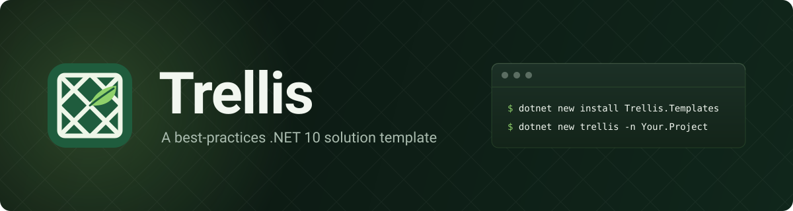
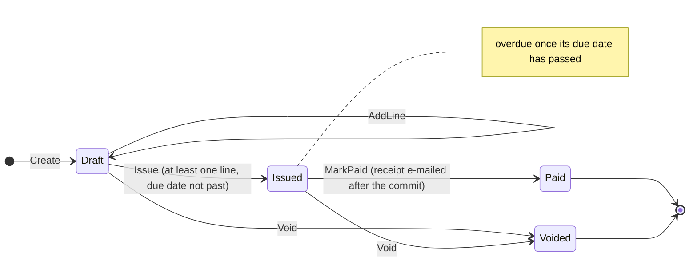
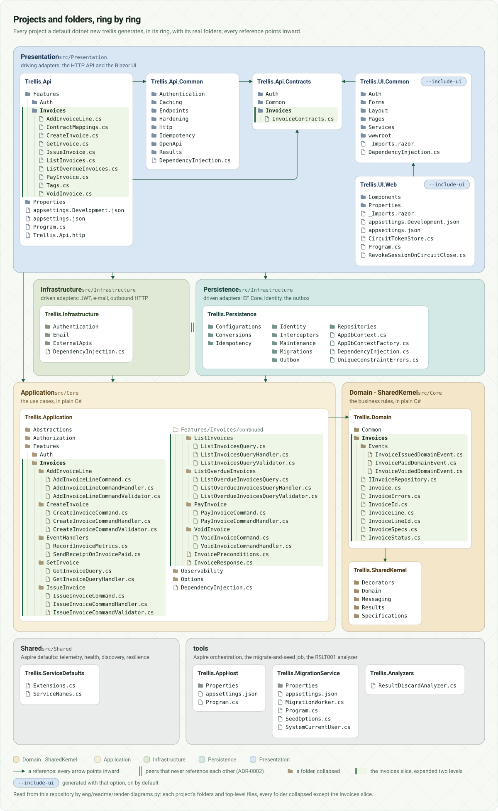
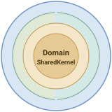
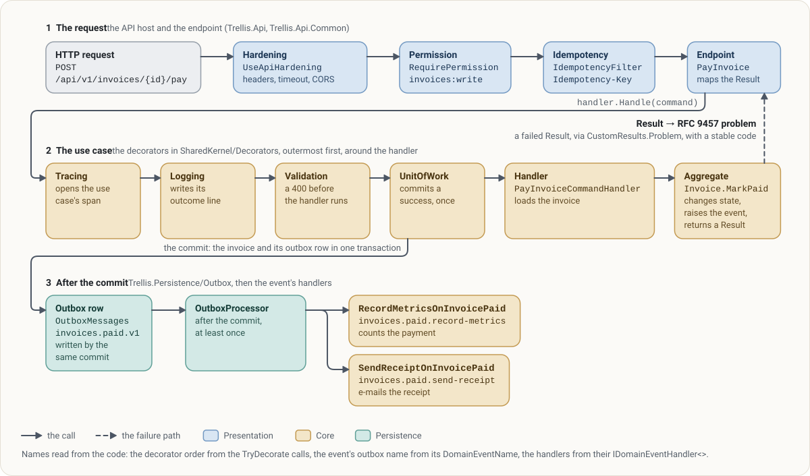
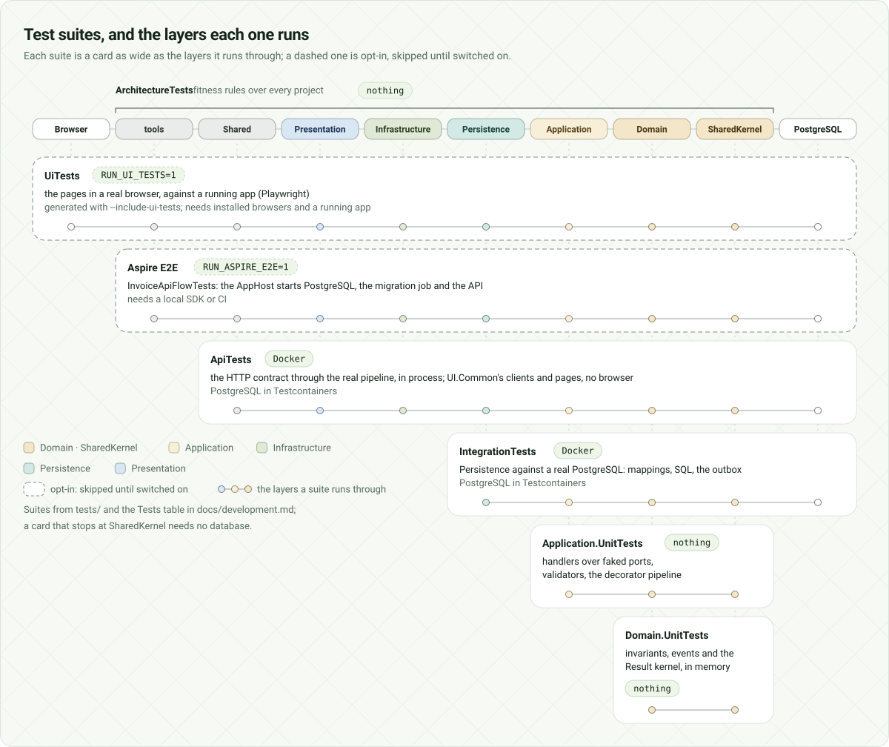

<div align="center">

<picture>
  <source media="(prefers-color-scheme: dark)" srcset="eng/readme/title-dark.svg">
  
</picture>

[](https://github.com/Revazi1st/Trellis/actions/workflows/template-ci.yml)
[](https://github.com/Revazi1st/Trellis/actions/workflows/ci.yml)
[](https://github.com/Revazi1st/Trellis/actions/workflows/codeql.yml)
[](https://dotnet.microsoft.com/)
[](LICENSE)
[](https://github.com/Revazi1st/Trellis/stargazers)

<!-- NuGet badges, after v0.1.0 is on nuget.org: move these two lines into the row above.
[](https://www.nuget.org/packages/Trellis.Templates)
[](https://www.nuget.org/packages/Trellis.Templates)
-->

</div>

**Trellis** is a `dotnet new` template for .NET 10 that generates a rich-DDD, Clean Architecture
solution: vertical-slice features, CQRS without a mediator, `Result`s instead of exceptions,
PostgreSQL, Identity with JWT, Aspire orchestration and an optional Blazor UI, in a repository written
for AI agents as carefully as for people. Like the lattice a gardener puts up for a climbing plant, it
carries the weight and sets the direction while your features grow, then disappears under them.

```bash
dotnet new install Trellis.Templates
dotnet new trellis -n Your.Project
```

Name the project with dot-separated parts made of letters and digits, each starting with a letter
(`Acme.Shop`): hyphens, spaces and underscores turn into underscores in namespaces, which analyzer rule
CA1707 rejects. To try `main` instead, install from a clone of this repository:

```bash
git clone https://github.com/Revazi1st/Trellis.git
dotnet new install ./Trellis                   # a folder install; `dotnet new uninstall ./Trellis` removes it
dotnet new trellis -n Your.Project -o Your.Project
```

Toggles (checkboxes in Visual Studio / Rider, flags on the CLI):

| Flag | Default | What it adds |
|---|---|---|
| `--include-ui` | on | Blazor web UI (UI.Common + UI.Web), orchestrated by Aspire |
| `--use-redis` | off | Redis distributed cache as a HybridCache L2 |
| `--use-serilog` | off | Serilog structured logging (console) alongside OpenTelemetry |
| `--use-multitenancy` | off | Tenant seam: `tenant` claim on the principal, `TenantId` column + `"Tenant"` query filter on every aggregate root ¹ |
| `--include-ui-tests` | off | Playwright browser tests for the Blazor UI (opt-in at run time) |
| `--skip-restore` | off | Skip the automatic `dotnet restore` |

¹ The shipped initial migration is generated without the tenant columns, so a project created with
`--use-multitenancy` regenerates it once before the first run
([docs/development.md](docs/development.md#multi-tenancy-optional); `dotnet new` prints the reminder).

## Table of contents 🧭

- [Give it a star ⭐](#give-it-a-star-)
- [Domain overview 🧾](#domain-overview-)
- [Use cases 📋](#use-cases-)
  - [Invoices](#invoices)
  - [Accounts](#accounts)
- [Getting started 🚀](#getting-started-)
  - [Before you start](#before-you-start)
  - [Create your solution](#create-your-solution)
  - [Run it](#run-it)
  - [Sign in](#sign-in)
  - [Walk an invoice through its life](#walk-an-invoice-through-its-life)
  - [Look at the data](#look-at-the-data)
- [Folder structure 📂](#folder-structure-)
- [How a request flows 🚦](#how-a-request-flows-)
- [Authorization 🔑](#authorization-)
- [Testing 🧪](#testing-)
- [Fun features 🎉](#fun-features-)
- [Toggles 🧩](#toggles-)
- [Built for AI agents 🤖](#built-for-ai-agents-)
- [Comparisons 🔭](#comparisons-)
- [Contribution 🤝](#contribution-)
- [Credits 💐](#credits-)
- [License 📜](#license-)

## Give it a star ⭐

If Trellis saves you a week of wiring, or shows you a pattern done the way you hoped to see it, star
the repository: stars are how other .NET developers find it. Thank you!

## Domain overview 🧾

The template ships one sample feature, invoicing: small enough to read in one sitting, and complete
enough to exercise every tactical pattern the template has. In plain words, before any architecture:

An invoice bills one customer, in one currency, for one or more lines of work. It starts as a
**draft**, the only state that takes new lines, and it is in the invoice list from the moment it
exists. **Issuing** it freezes the lines and sets a due date that may not lie in the past; once that
date passes, the invoice also shows up in the overdue list. **Paying** an issued invoice closes it and
e-mails the customer a receipt, **voiding** cancels a draft or an issued one, and a paid or voided
invoice never changes again. Administrators may do all of this; members may only read.



Every arrow is a method on `Invoice` that returns a `Result`. Called from the wrong state, it answers
409 (`Invoice.NotDraft`, `Invoice.NotIssued`, `Invoice.AlreadyIssued` or `Invoice.AlreadyFinalized`)
and changes nothing. [docs/features/invoices.md](docs/features/invoices.md) tells the rest, file by
file. When your own feature is due, the [`add-feature`](.claude/skills/add-feature/SKILL.md) skill
copies this slice layer by layer, and [`remove-feature`](.claude/skills/remove-feature/SKILL.md)
deletes it once yours exists.

## Use cases 📋

A use case is one folder under `src/Core/Trellis.Application/Features/<Feature>/`: a command or a
query, its `internal sealed` handler and, where there is input to check, a validator. Its endpoint is
one class under `src/Presentation/Api/Trellis.Api/Features/<Feature>/`.

### Invoices

| Use case | Request | Permission |
|---|---|---|
| **CreateInvoice**: a draft for one customer, in one currency | `POST /api/v1/invoices`, with an `Idempotency-Key` | `invoices:write` |
| **AddInvoiceLine**: a line of work on a draft | `POST /api/v1/invoices/{id}/lines` | `invoices:write` |
| **IssueInvoice**: freeze the lines and set a due date | `POST /api/v1/invoices/{id}/issue` | `invoices:write` |
| **PayInvoice**: close an issued invoice | `POST /api/v1/invoices/{id}/pay` | `invoices:write` |
| **VoidInvoice**: cancel a draft or an issued invoice | `POST /api/v1/invoices/{id}/void` | `invoices:write` |
| **GetInvoice**: one invoice, with its `ETag` | `GET /api/v1/invoices/{id}` | `invoices:read` |
| **ListInvoices**: every invoice, newest first, or those in one state | `GET /api/v1/invoices?status=Issued` | `invoices:read` |
| **ListOverdueInvoices**: issued invoices past their due date | `GET /api/v1/invoices/overdue` | `invoices:read` |

Once a command commits, the outbox delivers its events to three reactions: `SendReceiptOnInvoicePaid`
e-mails the receipt, and `RecordMetricsOnInvoiceIssued` and `RecordMetricsOnInvoicePaid` count issued
and paid invoices on the `Trellis.Invoices` meter. In the web UI, the Invoices page lists them with a
filter per state, an invoice's own page adds lines, issues, pays or voids it, and a form creates one.

### Accounts

| Use case | Request | Who may call it |
|---|---|---|
| **Register**: a Member account, while `Registration:Mode` is `Open` (Development opens it) | `POST /api/v1/auth/register` | anyone |
| **Login**: a short-lived access token (15 minutes by default) and a single-use refresh token | `POST /api/v1/auth/login` | anyone |
| **RefreshToken**: a new pair for a refresh token; presenting a spent one revokes all of the user's tokens | `POST /api/v1/auth/refresh` | whoever holds the token |
| **Logout**: revoke the refresh token presented | `POST /api/v1/auth/logout` | whoever holds the token |
| **RevokeSessions**: sign out everywhere | `POST /api/v1/auth/revoke-all` | a signed-in user |

Five wrong passwords lock an account for 15 minutes, and the `auth` rate limit gives one source ten
attempts a minute ([docs/features/auth.md](docs/features/auth.md)). One more piece is reference
material rather than a use case: `IExchangeRateProvider`, a port with a typed HTTP client behind it,
shows how to depend on an API you do not own
([docs/features/exchange-rates.md](docs/features/exchange-rates.md)).

## Getting started 🚀

### Before you start

- **Docker**: PostgreSQL, the integration tests (Testcontainers) and the SDK container need it. Docker
  Desktop and Linux Docker Engine are the tested engines; OrbStack, Colima and Podman are covered in
  [docs/development.md](docs/development.md#docker-engines-other-than-docker-desktop).
- **.NET 10 SDK** on the host, to run the orchestrated app. Building and testing work without it too,
  through `./scripts/dotnet.sh` (build its image once with
  `docker build -t trellis-sdk:10.0 scripts/sdk-image`) or the dev container.
- **Aspire CLI 13.5 or later** for `aspire run`: `dotnet tool install -g Aspire.Cli`. Optional, since
  `dotnet run --project tools/Trellis.AppHost` starts the same app.
- **PowerShell** (`pwsh`), only to install the browsers for the optional Playwright tests.

### Create your solution

```bash
dotnet new trellis -n Acme.Shop
cd Acme.Shop
```

Paths in this README are the template's own; in your solution, `Trellis` reads as your project's
name (`tools/Trellis.AppHost` becomes `tools/Acme.Shop.AppHost`). The solution arrives with its tests,
its CI (`.github/workflows/ci.yml` and `codeql.yml`), the docs, the ADRs and the AI assets, plus a
README of its own, an empty CHANGELOG and `.trellis-template.json`, which records the template version
and your options. On a private repository, the generated CodeQL job runs once code scanning is enabled
there and the `CODEQL_ENABLED` repository variable is `true`, and skips until then.

### Run it

```bash
aspire run                                   # PostgreSQL, migrations, the API and the web UI, under the Aspire dashboard
dotnet run --project tools/Trellis.AppHost   # the same app, without the Aspire CLI
```

From Rider or Visual Studio, run the **Trellis.AppHost** project: its `https` launch profile opens the
dashboard at <https://localhost:17171> (trust the development certificate once with
`dotnet dev-certs https --trust`), its `http` profile at <http://localhost:15171>, and a generated
solution picks free ports of its own when you create it. The dashboard lists `postgres`, the
`migrations` worker (it migrates, seeds and exits while the API waits), the `api` with a **Scalar**
link to its API reference, and the `web` UI.

No .NET SDK on your machine? Choose **Reopen in Dev Container**, start PostgreSQL with
`docker compose up -d` (host port 5433), then run **Trellis.MigrationService** once, **Trellis.Api**
(<http://localhost:5171>) and **Trellis.UI.Web** (<http://localhost:5170>) from their
`(dev container)` launch profiles. `aspire run` cannot orchestrate from inside a container
([ADR-0008](docs/adr/0008-containerized-sdk-and-aspire-orchestration.md));
[docs/development.md](docs/development.md) has the details.

### Sign in

However you run it, the migration worker seeds one administrator: `admin@example.com` /
`Admin123!`. Open the `web` resource and sign in, or get a token from the API with the first request
below.

### Walk an invoice through its life

Open [`src/Presentation/Api/Trellis.Api/Trellis.Api.http`](src/Presentation/Api/Trellis.Api/Trellis.Api.http)
in Rider, Visual Studio, or VS Code with the REST Client extension. Set `@host` to the `api` resource's
URL from the dashboard (the launch profiles and the dev container serve `http://localhost:5171`) and
choose the `dev` environment, which `src/Presentation/Api/http-client.env.json` fills with the seeded
admin and a demo member. Then send the requests in order, starting with a sign-in:

```http
POST {{host}}/api/v1/auth/login
Content-Type: application/json

{
  "email": "{{adminEmail}}",
  "password": "{{adminPassword}}"
}
```

The answer is a 200 with an `accessToken`: paste it into `@token`. Next, create a draft. The create
requires an `Idempotency-Key`, because a repeated create would otherwise be a second draft:

```http
POST {{host}}/api/v1/invoices
Authorization: Bearer {{token}}
Content-Type: application/json
Idempotency-Key: {{createKey}}

{
  "customerName": "Ada Lovelace",
  "customerEmail": "ada@example.com",
  "currency": "EUR"
}
```

A 201 comes back with a `Location` header and the new `id`, which goes into `@invoiceId`. The next
requests list the invoices (your draft comes first), add a line, issue it, read it back with its
`ETag` and again with `If-None-Match` for a 304, and pay it. Seconds later the api's log shows the
receipt (logged rather than sent until you configure SMTP), handed to `SendReceiptOnInvoicePaid` by
the outbox after the commit. The last five requests show the guard rails: issuing again with the
`ETag` from before the payment is a 412, the create replayed with the same key returns the first 201
with `Idempotency-Replayed: true`, and a member who registers and signs in gets a 403 for a create.
[docs/features/invoices.md](docs/features/invoices.md#try-it) tables all thirteen steps with their
answers.

Rather click? The `api` resource's **Scalar** link opens the API reference at `/scalar/v1`, which
takes the same bearer token, and the `web` UI walks the same lifecycle: sign in as the admin, create an
invoice, then add a line, issue and pay it from its page.

### Look at the data

Beside `postgres`, the dashboard has a **pgAdmin** tile, and a solution generated with
`--use-redis true` has a **RedisInsight** tile beside the `cache` resource too. Both open without a
login.

## Folder structure 📂

<picture>
  <source media="(prefers-color-scheme: dark)" srcset="eng/readme/architecture-dark.svg">
  
</picture>

Projects are grouped by ring, and a feature is a vertical slice through them: the invoice use cases
are folders in Application, their endpoints are classes in Api, and their mapping lives in
Persistence. Dependencies point inward, and `LayerDependencyTests` fails when one points the wrong
way. Infrastructure and Persistence are peers that never reference each other, where the mainstream
templates ship one Infrastructure project with a Persistence folder inside
([ADR-0002](docs/adr/0002-infrastructure-persistence-split.md)).

<picture>
  <source media="(prefers-color-scheme: dark)" srcset="eng/readme/rings-dark.svg">
  
</picture>

| Ring | Projects | What lives there |
|---|---|---|
| **Core** | SharedKernel, Domain, Application | business rules and use cases, in plain C# |
| **Infrastructure** | Infrastructure, Persistence | the driven adapters: e-mail, JWT and outbound HTTP; EF Core and Identity |
| **Presentation** | Api, Api.Common, Api.Contracts; UI.Common, UI.Web | the driving adapters: the HTTP API and the Blazor UI |
| **Shared** | ServiceDefaults | Aspire's cross-cutting defaults: OpenTelemetry, health, service discovery, resilience |
| `tools` | AppHost, MigrationService, Analyzers | orchestration, the migrate-and-seed worker, the RSLT001 analyzer |

The pictures are drawn from the solution tree by
[`eng/readme/render-diagrams.py`](eng/readme/render-diagrams.py), in a light and a dark version. They
are plain SVG, so Figma or Inkscape opens them as editable vectors.
[docs/architecture.md](docs/architecture.md) describes the rings and the key patterns in words.

## How a request flows 🚦

<picture>
  <source media="(prefers-color-scheme: dark)" srcset="eng/readme/pipeline-dark.svg">
  
</picture>

There is no mediator. Each endpoint is one class that takes its handler straight from dependency
injection, and four decorators wrap every handler, outermost first: **Tracing** opens the use case's
span, **Logging** writes one outcome line inside it, **Validation** runs the validators and answers
400 before the handler is reached, and **UnitOfWork**, for commands only, commits a successful
`Result` once and a failed one never. `DecoratorPipelineTests` pins that order
([ADR-0003](docs/adr/0003-hand-rolled-cqrs.md)). Paying an invoice is this whole handler
([`PayInvoiceCommandHandler.cs`](src/Core/Trellis.Application/Features/Invoices/PayInvoice/PayInvoiceCommandHandler.cs)):

```csharp
internal sealed class PayInvoiceCommandHandler(IInvoiceRepository invoices, TimeProvider timeProvider)
    : ICommandHandler<PayInvoiceCommand>
{
    public async Task<Result> Handle(PayInvoiceCommand command, CancellationToken cancellationToken)
    {
        Invoice? loaded = await invoices.GetByIdAsync(command.InvoiceId, cancellationToken);

        return loaded.ToWrite(command.InvoiceId, command.ExpectedVersion)
            .Bind(invoice => invoice.MarkPaid(timeProvider.GetUtcNow()));
    }
}
```

`ToWrite` answers 404 for a missing invoice and 412 for a stale `If-Match`. The rule itself lives in
the aggregate, which reports a refusal as a value instead of throwing
([`Invoice.cs`](src/Core/Trellis.Domain/Invoices/Invoice.cs)):

```csharp
public Result MarkPaid(DateTimeOffset paidAtUtc)
{
    if (Status != InvoiceStatus.Issued)
    {
        return Result.Failure(InvoiceErrors.NotIssued);
    }

    Status = InvoiceStatus.Paid;
    PaidAtUtc = paidAtUtc;
    Raise(new InvoicePaidDomainEvent(Id, CustomerEmail.Value));
    return Result.Success();
}
```

The endpoint turns a failed `Result` into an RFC 9457 problem whose stable `code` clients branch on
(`Invoice.NotIssued`, 409), through one seam for the whole API
([ADR-0004](docs/adr/0004-result-over-exceptions.md), [ADR-0024](docs/adr/0024-problem-details-v2.md)).
A `Result` that nobody reads is a bug the compiler can see, so analyzer **RSLT001** fails the Release
build on a statement that drops one; `_ = …` with a one-line reason is the only deliberate discard
([ADR-0030](docs/adr/0030-discarded-result-analyzer.md)).

`Raise` sends nothing. `OutboxWriteInterceptor` writes the event to `OutboxMessages` in the same
transaction as the invoice, and after the commit `OutboxProcessor` hands it to
`SendReceiptOnInvoicePaid`, crediting that handler under its stable `[DomainEventHandlerName]`, so a
retry never runs a handler that already succeeded
([ADR-0018](docs/adr/0018-transactional-outbox-and-idempotency.md),
[ADR-0023](docs/adr/0023-outbox-lease-and-checkpoints.md)).
[docs/architecture.md](docs/architecture.md#a-request-stage-by-stage) takes a request through all
eight stages, and [docs/features/invoices.md](docs/features/invoices.md#from-a-payment-to-its-receipt)
draws the path from a payment to its receipt.

## Authorization 🔑

Secure by default: every endpoint on the versioned API group requires a signed-in caller, and four
auth endpoints (register, login, refresh and logout) are the whole anonymous allowlist. On top of
that, each endpoint names the one permission it needs from the catalogue in
[`Permissions.cs`](src/Core/Trellis.Application/Authorization/Permissions.cs), and the seeded roles
grant them: an **Administrator** holds every permission, a **Member** holds `invoices:read`. A token
carries one `permission` claim per permission its user's roles grant. Paying an invoice
([`PayInvoice.cs`](src/Presentation/Api/Trellis.Api/Features/Invoices/PayInvoice.cs)):

```csharp
public static RouteHandlerBuilder Map(IEndpointRouteBuilder app) => app
    .MapPost("invoices/{id}/pay", Handle)
    .RequirePermission(Permissions.Invoices.Write)
    .RequireIdempotency()
    .SupportsConditionalWrite()
    // … then the tags, summary and description for the OpenAPI document
```

| Who calls it | What they get |
|---|---|
| a token carrying `invoices:write` (the seeded admin) | the endpoint's own answer: 204 once paid, or the invoice's 404, 409 or 412 |
| a valid token without it (a member) | **403** `Auth.Forbidden` |
| no token, or one that fails validation | **401** `Auth.Unauthenticated`, with `WWW-Authenticate: Bearer` |

The other shapes follow the same how-to
([docs/features/auth.md](docs/features/auth.md#protecting-an-endpoint)): an action on the caller's own
account needs only a signed-in caller (`revoke-all`); an anonymous endpoint calls `.AllowAnonymous()`
and joins the allowlist, with the `auth` rate limit when it takes a guessable credential; a permission
plus a further condition stacks a named policy beside it; and a rule about *which* record (its owner,
a team) belongs to the feature and answers 404, as for a record that does not exist. A new permission
is a constant in `Permissions`, listed in `Permissions.All` and granted to a role in
`Roles.Permissions`.

## Testing 🧪

<picture>
  <source media="(prefers-color-scheme: dark)" srcset="eng/readme/testing-dark.svg">
  
</picture>

Each test project proves one thing about one part of the solution:

| Project | Proves | Needs |
|---|---|---|
| `Domain.UnitTests` | every invariant and transition of an aggregate, the events it raises, value objects, specifications, the `Result` kernel | nothing |
| `Application.UnitTests` | each handler over faked ports, the validators and event handlers, and the decorator pipeline itself | nothing |
| `ArchitectureTests` | the rules files hold: layer boundaries, conventions, the error-code vocabulary, options validated at boot, telemetry names | nothing |
| `IntegrationTests` | Persistence against a real PostgreSQL: mappings, specifications as SQL, interceptors, concurrency, the outbox, the idempotency store, the migration matching the model | Docker |
| `ApiTests` | the HTTP contract through the real pipeline: each endpoint's permission, problem details, idempotency, caching and conditional requests, the served OpenAPI document; plus an opt-in Aspire end-to-end test | Docker; the end-to-end test also `RUN_ASPIRE_E2E=1` and a local SDK or CI |
| `UiTests` (`--include-ui-tests`) | the pages in a real browser against a running app | `RUN_UI_TESTS=1`, installed browsers, a running app |

Most of a feature's tests belong in `Domain.UnitTests` and `IntegrationTests`: a rule is cheapest to
pin where it lives, and a query or a transaction only proves itself against PostgreSQL. The fitness
suites already cover every endpoint's permission, problem shape, idempotency and OpenAPI entry, so an
`ApiTests` test is for what they cannot see. [docs/development.md](docs/development.md#tests) maps where
a new test belongs and which helper serves which goal.

```bash
dotnet test Trellis.slnx                                  # everything; the Aspire E2E skips unless RUN_ASPIRE_E2E=1
./scripts/dotnet.sh test Trellis.slnx                     # the same through the SDK container, no local SDK
./scripts/dotnet.sh test tests/Trellis.Domain.UnitTests   # one project
```

**Conventions are tests, not prose.** `LayerDependencyTests` holds the arrows of the pictures above,
`ConventionTests` refuses a handler that runs another use case, `ErrorCodeVocabularyTests` keeps every
error code in `Area.Problem` form with one meaning, `OptionsConventionTests` boots the API with broken
settings, `TelemetryNamingTests` holds the telemetry reference in `docs/deployment.md` to the code, and
`EndpointMetadataTests` pins each endpoint's permission. Every rule has a positive control: a planted
violation it must catch (`PlantedViolations`).

**Gates beyond the tests:**

- The served OpenAPI document must equal the committed
  [docs/api/openapi.v1.json](docs/api/openapi.v1.json) (`OpenApiSnapshotTests`, and CI diffs it against
  the running app too). After an endpoint or contract change, regenerate it with
  `UPDATE_OPENAPI_SNAPSHOT=1 dotnet test tests/Trellis.ApiTests`.
- A pull request that changes a feature's code without its `docs/features/<feature>.md`, or
  authentication and hardening code without [docs/threat-model.md](docs/threat-model.md), fails
  `scripts/check-docs-drift.sh`; `scripts/check-adr-links.sh` resolves every ADR reference, rule glob
  and relative link.
- Line coverage has a floor per ring: Core 90 %, Infrastructure 85 %, Presentation 75 %, Shared 80 %.
- Every pull request also tests what the template generates. Template CI creates a solution per toggle
  leg (default, no UI, UI tests without the UI, all options), checks it for leftovers of the
  template's name, builds it in Release and runs the tests of the default, no-UI and all-options legs.
  It repeats the default on Windows and builds a project from the packed `.nupkg`.

## Fun features 🎉

**Idempotency keys that replay.** `POST /invoices` requires an `Idempotency-Key`. The reservation
commits with the command, so a failed command leaves none; a retry with the same key and body gets the
stored response byte for byte, with `Idempotency-Replayed: true`; the same key with another body is a
422, and a retry while the first request is still running a 409 with `Retry-After`
([ADR-0018](docs/adr/0018-transactional-outbox-and-idempotency.md),
[runbook](docs/deployment.md#idempotency-keys)).

**ETags and `If-Match`.** `GET /invoices/{id}` sends a strong `ETag` from the row's version, and
`If-None-Match` turns an unchanged read into a 304 with no body. The four invoice writes take
`If-Match`: a stale tag is a 412 `Invoice.VersionMismatch` that changes nothing, so a colleague's new
line can no longer be issued unseen ([docs/features/invoices.md](docs/features/invoices.md)).

**An outbox that leases and checkpoints.** The processor claims due rows with `FOR UPDATE SKIP LOCKED`
and leases them, so two replicas never dispatch the same row at once, and a processor that outlived
its lease cannot overwrite the next one's bookkeeping. Each handler is credited at its own checkpoint, only the failed
ones are retried, with back-off from 30 s to 15 min, and the eighth failure dead-letters the row for a
SQL re-drive ([ADR-0023](docs/adr/0023-outbox-lease-and-checkpoints.md),
[runbook](docs/deployment.md#outbox-operations)).

**Multi-tenancy on the principal** (`--use-multitenancy`). The tenant comes from the `tenant` claim
minted at sign-in and from nowhere else: there is no tenant header, and a token without the claim is
refused. Every aggregate root gets a `TenantId` column and a `"Tenant"` query filter by convention, so
another tenant's invoice is a 404 ([ADR-0022](docs/adr/0022-tenant-on-the-principal.md)).

**HybridCache, with Redis behind it.** `GET /invoices/{id}` is cache-aside: an in-memory copy for 30
seconds always, and with `--use-redis` a Redis copy for five minutes that every replica shares. Keys
come from one `CacheKeys` service (tenant-scoped under multi-tenancy), every write evicts after its
commit, and a 404 is never cached ([ADR-0026](docs/adr/0026-read-caching.md)).

**SMTP by configuration.** E-mail is logged, not sent, until `Email:Provider=Smtp` and an `Email:Smtp`
section point at a relay, validated at boot only while selected. A failed send throws, so the outbox
tries again; [docs/development.md](docs/development.md#secrets) has the user-secrets lines and a
Mailpit recipe for seeing the mail on your machine.

**A dropped `Result` fails the build.** RSLT001, from `tools/Trellis.Analyzers`, is loaded into every
project, the tests included: a discarded `Result`, `Error`, `IdentityResult` or UI `ApiResult<T>` is a
warning in Debug and an error in Release, and so is a `Task<Result>` handed on as a plain `Task`
([ADR-0030](docs/adr/0030-discarded-result-analyzer.md)).

**Each endpoint's permission, pinned.** `EndpointMetadataTests.ExpectedPermissions` lists every
endpoint with its one permission and fails on a missing, extra or stale row, and a wire-level test
calls each endpoint with only that permission and with every other one, expecting its own answer and
then a 403 ([Authorization](#authorization-)).

**Dependency bumps that merge themselves.** Dependabot holds a new version back for a week (a security
update arrives at once), and
[`dependabot-auto-merge.yml`](.github/workflows/dependabot-auto-merge.yml) merges its patch and minor
pull requests once the required checks pass, where the repository allows auto-merge and `main` requires
status checks. A major, a .NET SDK bump and the GitHub Actions group wait for a person, and
`NuGetAudit` fails a Release build on a vulnerable package, transitive ones included
([ADR-0029](docs/adr/0029-central-package-management.md)).

## Toggles 🧩

The table at the top lists the options; this is what each one changes in the generated solution.

- **`--include-ui false`** leaves out `src/Presentation/UI/`, the UI client tests in
  `tests/Trellis.ApiTests/Ui/` and the UI rule, and the AppHost starts no `web` resource: an API-only
  solution.
- **`--use-redis true`** adds the `cache` resource with its RedisInsight tile and makes Redis the
  HybridCache L2. In the dev-container flow, `docker compose --profile redis up -d` starts it.
- **`--use-serilog true`** sends the API's and the web host's logs through Serilog's console sink,
  while OpenTelemetry keeps exporting them (`SerilogExportTests`).
- **`--use-multitenancy true`** adds `ITenantContext`, `TenantInterceptor` and the tenancy suites
  (`TenancyTests`, `TenantIsolationTests`); regenerate the initial migration once, as the footnote above
  says.
- **`--include-ui-tests true`** adds `tests/Trellis.UiTests` (Playwright), which skips unless
  `RUN_UI_TESTS=1`. It needs the UI, so `--include-ui false` drops it again.

Your choices are recorded in `.trellis-template.json`, from which
[docs/upgrading.md](docs/upgrading.md) regenerates when you adopt a later template version. A folder
install records `0.0.0-source` there as the template version; packing first
(`dotnet pack eng/Trellis.TemplatePack -o nupkg`) and installing the `.nupkg` records the package
version instead.

## Built for AI agents 🤖

The repository is written for an agent to work in as much as for a person, and every piece of that is
plain text you can read too.

- **[AGENTS.md](AGENTS.md)**: the commands, the dependency flow and the boundaries, in the
  tool-neutral format. `CLAUDE.md` imports it, and `.github/copilot-instructions.md` points Copilot at
  it ([ADR-0014](docs/adr/0014-ai-documentation-architecture.md)).
- **Path-scoped rules** in `.claude/rules/`, one per layer plus the tests and the tools, each loaded
  when an agent touches a file its glob matches: the domain rules arrive with the first edit under
  `src/Core/Trellis.Domain/`.
- **Skills** in `.claude/skills/`, step-by-step recipes:
  [`add-feature`](.claude/skills/add-feature/SKILL.md) (a checklist that names the test behind each
  enforced box), [`remove-feature`](.claude/skills/remove-feature/SKILL.md),
  [`add-integration`](.claude/skills/add-integration/SKILL.md),
  [`add-migration`](.claude/skills/add-migration/SKILL.md), [`new-adr`](.claude/skills/new-adr/SKILL.md)
  and [`run-app`](.claude/skills/run-app/SKILL.md). An agent follows them, and so can you.
- **Reviewers** in `.claude/agents/`: `code-reviewer` and `architecture-guard`, whose findings are
  claims to check against the code before acting on them.
- **Decisions** in [docs/adr/](docs/adr/), indexed in [docs/INDEX.md](docs/INDEX.md): each with its
  context and consequences and, where it takes an idea from another project, a *Prior art* line naming
  it. Your own start at 0100.
- **Drift gates**: the edit hook and CI's docs-drift job, the link check, the OpenAPI snapshot and the
  fitness tests turn the docs and the conventions into something a change can fail.
- **[.mcp.json](.mcp.json)** wires up the Microsoft Learn, Context7 and Playwright MCP servers.

The release runbook adds an agent dry run before each minor version: an agent builds one fixed feature
in a freshly generated project with nothing but that repository to go on, and the existing gates judge
the result ([docs/releasing.md](docs/releasing.md)).

## Comparisons 🔭

Trellis is measured against
[amantinband/clean-architecture](https://github.com/amantinband/clean-architecture),
[xavierjohn/Trellis](https://github.com/xavierjohn/Trellis) (no relation; the shared name is a
coincidence) and [jasontaylordev/CleanArchitecture](https://github.com/jasontaylordev/CleanArchitecture).
Every idea taken from them is credited by name below, and a project we only compared against gets no
line. The largest structural difference from the mainstream templates, Infrastructure and Persistence
as two peer projects, is recorded in [ADR-0002](docs/adr/0002-infrastructure-persistence-split.md).

## Contribution 🤝

Found a bug, or missing a feature? Issues and pull requests are welcome, and
[CONTRIBUTING.md](CONTRIBUTING.md) says what to run before a pull request, how to test a change against
the projects the template generates, and how to write the commits. Questions, and ideas you want to try
out first, go to [GitHub Discussions](https://github.com/Revazi1st/Trellis/discussions); a
vulnerability goes through [SECURITY.md](SECURITY.md), never a public issue. Every version's changes
are in [CHANGELOG.md](CHANGELOG.md), and [docs/INDEX.md](docs/INDEX.md) indexes the docs for people and
agents alike.

<a name="credits"></a>

## Credits 💐

Trellis takes ideas from other people's work. Each line names what was taken; nothing below is a
verbatim copy, so the MIT and BSD notices stay with their projects. Templates we only compared
against are not listed (ADR-0002 names them). A line marked *when adopted* or *once imported*
describes planned work that is not in the template yet; the marker goes when it lands.

**Templates and libraries we learned from**
- [clean-architecture](https://github.com/amantinband/clean-architecture) by Amichai Mantinband (MIT):
  - the per-use-case request collection and the Getting Started walkthrough, one request and body per step;
  - a configuration-gated SMTP sender and the user-secrets setup walkthrough;
  - the Domain Overview device, plain words before architecture, and the folder map that prompted our slice tree;
  - one authorization test per use case, which prompted pinning each endpoint's permission, and the permission-scoped token idiom;
  - use-case drivers, optional-parameter factories, the paired HTTP test client and the switchable current-user double (rewritten, no MediatR);
  - the one-test-suite-per-use-case discipline with test folders mirroring the Application slice;
  - the eventual-consistency walkthrough shape, the one-aggregate-per-use-case explanation, and the idea of a reference time-triggered use case;
  - the Testing section mapping each test type onto the layers it exercises, and where to invest;
  - the authorization how-to format, one snippet then who passes, and the self-or-admin idea behind our ownership recipe;
  - the show-the-code README sections;
  - the visual walkthrough-style README: an icon on each heading, a request for a star, the domain before the architecture, a request walkthrough and pictures of the folders and the tests (the pictures and the words are our own);
  - *when adopted*: feature-first folders in the persistence adapter.
- [Trellis](https://github.com/xavierjohn/Trellis) by Xavier John (MIT; no affiliation, the shared name is a coincidence):
  - lease-fenced outbox bookkeeping writes, and sibling event handlers run on every attempt with only the failed ones retried;
  - failing fast when a `Result` reaches JSON, a failed `Result` that names its code, and compiler-guarded `Error` access;
  - value-object errors attributed to the request field, a type-aware and tuple `Result.Combine`, and whole-request validation errors;
  - error descriptions redacted from the outcome log line, and tracing outside logging;
  - concurrency promotion at the aggregate boundary, and declared unique constraints as 409;
  - the guard against a handler invoking another handler;
  - error descriptions redacted from every 5xx `detail`;
  - upstream status mapped by endpoint contract, `Unavailable` as 503, and optional `If-Match` on transition POSTs;
  - the error-code vocabulary fitness test and the value-object constructor test;
  - the build-time analyzer for a discarded `Result`.
- [CleanArchitecture](https://github.com/jasontaylordev/CleanArchitecture) by Jason Taylor (MIT):
  - stamping audit columns with the user's id rather than a display name (`AuditableEntityInterceptor`);
- [Ardalis.Specification](https://github.com/ardalis/Specification) by Steve Smith (MIT): the usage shape of `Specification<T>` (ADR-0017).
- [SSW.CleanArchitecture](https://github.com/SSWConsulting/SSW.CleanArchitecture) (MIT): the migration worker that migrates, seeds and stops while the API waits (`MigrationWorker.cs`).
- [Aspire ServiceDefaults](https://github.com/dotnet/aspire) project template by Microsoft (MIT): the shape and method names of `Trellis.ServiceDefaults/Extensions.cs`.

**Formats and conventions**
- [Michael Nygard's ADR format](https://cognitect.com/blog/2011/11/15/documenting-architecture-decisions): Status, Context, Decision, Consequences (ADR-0001).
- [AGENTS.md](https://agents.md): the tool-neutral agent instruction file (ADR-0014).
- [Contributor Covenant 2.1](https://www.contributor-covenant.org) (CC BY 4.0): `CODE_OF_CONDUCT.md`.
- [Keep a Changelog 1.1.0](https://keepachangelog.com/en/1.1.0/) and [Semantic Versioning 2.0.0](https://semver.org/spec/v2.0.0.html): `CHANGELOG.md` and the release rules.
- [Conventional Commits](https://www.conventionalcommits.org): the commit style in `CONTRIBUTING.md`.
- Martin Fowler's [subcutaneous test](https://martinfowler.com/bliki/SubcutaneousTest.html) term, used for the integration-test host.

**Services**
- [Frankfurter](https://frankfurter.dev): the free exchange-rate API the reference integration calls by default.

Packages carry their own licenses; see `Directory.Packages.props` and ADR-0011.

## License 📜

MIT — see [LICENSE](LICENSE). A generated project keeps that notice as `LICENSE`, because the MIT
terms require it to travel with substantial portions of the template, but it does not license your
product: the generated README asks you to add your own terms. The NuGet packages a generated
solution references carry their own licenses; [ADR-0011](docs/adr/0011-license-ceiling-policy.md)
explains the ceilings the build enforces.
