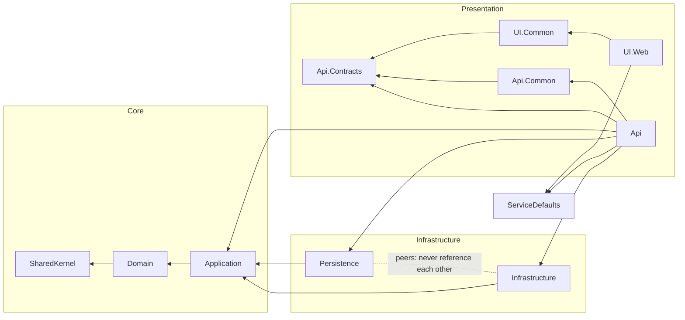

# Trellis

[](https://github.com/Revazi1st/Trellis/actions/workflows/ci.yml)
[](https://github.com/Revazi1st/Trellis/actions/workflows/template-ci.yml)
[](https://www.nuget.org/packages/Trellis.Templates)
[](LICENSE)
[](https://dotnet.microsoft.com/)

```bash
dotnet new install Trellis.Templates
dotnet new trellis -n Your.Project
```

A best-practices .NET 10 **solution template**: rich DDD, Clean Architecture with vertical-slice features, feature-based Minimal APIs, separate Infrastructure and Persistence, ASP.NET Identity + JWT, Aspire orchestration, a Blazor UI, and a deeply **AI-friendly** repository (dual human/AI docs, Claude Code rules/agents/skills/hooks). Every major feature is a toggle, so you scaffold only what you need.

> **Why "Trellis"?** A trellis is the lattice frame a gardener puts up for climbing plants: it
> carries the weight and shapes the direction of growth, and once the plant fills out, the frame
> disappears under the leaves. That is exactly what this template aims to be — the load-bearing
> structure (layers, pipeline, conventions, CI) your application grows over until the scaffolding
> fades from view.

## Use the template

The two lines above install the latest release from nuget.org and generate a solution;
[CHANGELOG.md](CHANGELOG.md) says what each version contains. To try `main` instead, install from a
clone of this repository:

```bash
git clone https://github.com/Revazi1st/Trellis.git
dotnet new install ./Trellis                   # a folder install; `dotnet new uninstall ./Trellis` removes it
dotnet new trellis -n Your.Project -o Your.Project
```

A folder install records `0.0.0-source` as the template version in the generated project's
marker (below); packing first (`dotnet pack eng/Trellis.TemplatePack -o nupkg`) and installing the
`.nupkg` records the package version instead.

Toggles (checkboxes in Visual Studio / Rider, flags on the CLI):

| Flag | Default | What it adds |
|---|---|---|
| `--include-ui` | on | Blazor web UI (UI.Common + UI.Web), orchestrated by Aspire |
| `--use-redis` | off | Redis distributed cache as a HybridCache L2 |
| `--use-serilog` | off | Serilog structured logging (console) alongside OpenTelemetry |
| `--use-multitenancy` | off | Tenant seam: `tenant` claim on the principal, `TenantId` column + `"Tenant"` query filter on every aggregate root ¹ |
| `--include-ui-tests` | off | Playwright browser tests for the Blazor UI (opt-in at run time) |
| `--skip-restore` | off | Skip the automatic `dotnet restore` |

¹ The shipped initial migration is generated without the tenant columns, so a project created with
`--use-multitenancy` regenerates it once before the first run
([docs/development.md](docs/development.md#multi-tenancy-optional); `dotnet new` prints the reminder).

### What a generated project contains

The solution, its tests, CI (`.github/workflows/ci.yml` and `codeql.yml`), the docs, the ADRs and the
AI assets, all renamed after your project. It does **not** inherit this repository's own README,
CHANGELOG, contributing and security policies, code owners, issue forms or release runbook: it gets a
README written for the project, an empty CHANGELOG, and `.trellis-template.json`, which records the
template version and the options used ([docs/upgrading.md](docs/upgrading.md) regenerates from it).
`LICENSE` stays this template's MIT notice; see *License* below.

**CodeQL on a private repository**: code scanning is free on public repositories and part of GitHub
Advanced Security on private ones. The generated `codeql.yml` runs on a public repository, and on a
private one only once code scanning is enabled there and the `CODEQL_ENABLED` repository variable
(Settings → Secrets and variables → Actions → Variables) is `true`; without that, a private
repository skips the job instead of failing its upload every week.

### Naming your project

Use dot-separated parts made of letters and digits, each starting with a letter (`Acme.Shop`).
Hyphens, spaces and underscores become underscores in namespaces (`acme-shop` → `acme_shop`), and the build fails on analyzer rule CA1707.

## Prerequisites

- **Docker**: PostgreSQL, the integration tests (Testcontainers) and the SDK container all need it.
  This repository's own runs exercise Docker Desktop, and the `sdk-container` CI job covers Linux
  Docker Engine. OrbStack, Colima and Podman should work with the settings in
  [docs/development.md](docs/development.md#docker-engines-other-than-docker-desktop), but nothing
  here tests them.
- **.NET 10 SDK** on the host, to run the orchestrated app. Build and tests also run without it,
  through `./scripts/dotnet.sh` or the dev container.
- **Aspire CLI 13.5 or later** for `aspire run`, a separate install from the SDK:
  `dotnet tool install -g Aspire.Cli` (check with `aspire --version`). Optional:
  `dotnet run --project tools/Trellis.AppHost` starts the same app without it.
- **PowerShell** (`pwsh`), only to install the Playwright browsers for the optional UI tests.

## Develop it

No .NET SDK on your machine? Open the solution and choose **Reopen in Dev Container** — the IDE
backend runs inside the SDK image, so you get full IntelliSense/build/debug with nothing installed
on the host. See [docs/development.md](docs/development.md).

## Run it

With a local .NET SDK, one command wires up everything:

```bash
aspire run                                   # PostgreSQL + migrations + API (Scalar at /scalar/v1) + Blazor UI + dashboard
dotnet run --project tools/Trellis.AppHost   # the same, without the Aspire CLI
```

From the **dev container** (no local SDK), start the dependencies and launch the projects from your
IDE with the `… (dev container)` profiles — `aspire run` can't orchestrate from inside a container
([ADR-0008](docs/adr/0008-containerized-sdk-and-aspire-orchestration.md)):

```bash
docker compose up -d    # PostgreSQL on host port 5433
```

then run **MigrationService** once, then **Trellis.Api** (<http://localhost:5171>) and
**Trellis.UI.Web** (<http://localhost:5170>).

Seeded admin: `admin@example.com` / `Admin123!`. Full detail in [docs/development.md](docs/development.md).

The app ships one sample feature, invoicing, and
[docs/features/invoices.md](docs/features/invoices.md) explains it in plain words before any
architecture: an invoice's states, the rules between them and where each file lives. Its
[*Try it*](docs/features/invoices.md#try-it) section then walks the lifecycle one request at a time
from `src/Presentation/Api/Trellis.Api/Trellis.Api.http` (sign in, create, add a line, issue, a
304, pay, an idempotent replay and a member's 403), and the web UI clicks through the same steps.

## The code, in two excerpts

An aggregate method checks its rule, changes its state, raises an event, and reports a refusal as a value
instead of an exception
([`src/Core/Trellis.Domain/Invoices/Invoice.cs`](src/Core/Trellis.Domain/Invoices/Invoice.cs)):

```csharp
public Result MarkPaid(DateTimeOffset paidAtUtc)
{
    if (Status != InvoiceStatus.Issued)
    {
        return Result.Failure(InvoiceErrors.NotIssued);
    }

    Status = InvoiceStatus.Paid;
    PaidAtUtc = paidAtUtc;
    Raise(new InvoicePaidDomainEvent(Id, CustomerEmail.Value));
    return Result.Success();
}
```

The event is written to the outbox in the same transaction as the payment, and after the commit it
reaches a handler that knows nothing of HTTP or EF Core
([`src/Core/Trellis.Application/Features/Invoices/EventHandlers/SendReceiptOnInvoicePaid.cs`](src/Core/Trellis.Application/Features/Invoices/EventHandlers/SendReceiptOnInvoicePaid.cs)):

```csharp
[DomainEventHandlerName("invoices.paid.send-receipt")]
internal sealed class SendReceiptOnInvoicePaid(IEmailSender emailSender)
    : IDomainEventHandler<InvoicePaidDomainEvent>
{
    public Task Handle(InvoicePaidDomainEvent domainEvent, CancellationToken cancellationToken)
        => emailSender.SendAsync(
            domainEvent.CustomerEmail,
            "Thanks for your payment",
            $"We received the payment for invoice {domainEvent.InvoiceId}.",
            cancellationToken);
}
```

Between the two, the endpoint turns the `Result` into a 204 or an RFC 9457 problem, and the outbox
credits the handler under its stable name so a retry never sends the receipt twice;
[docs/features/invoices.md](docs/features/invoices.md#from-a-payment-to-its-receipt) draws the whole path.

## Architecture

Dependencies point inward; the arrows are enforced by `ArchitectureTests`.



| Group | Projects | Role |
|---|---|---|
| `src/Core` | SharedKernel, Domain, Application | The inside of the onion — pure C#, no framework deps |
| `src/Infrastructure` | Infrastructure ∥ Persistence | Driven adapters (peers — no cross-reference) |
| `src/Presentation/Api` | Api.Contracts, Api.Common, Api | Feature-based Minimal API host + shared plumbing + public contracts |
| `src/Presentation/UI` | UI.Common, UI.Web | Shared Blazor component library + the web host |
| `src/Shared` | ServiceDefaults | Aspire service defaults (OTel, health, discovery, resilience) |
| `tools` | AppHost, MigrationService | Aspire orchestration + DB migrate/seed worker |
| `tests` | 6 projects | Domain and Application unit tests, architecture, integration (Testcontainers), API (the in-process HTTP pipeline + the opt-in Aspire E2E), and Playwright UI tests (only with `--include-ui-tests`) |

What each test project proves, what it needs, and which one a new test belongs in is mapped in
[docs/development.md](docs/development.md#tests).

## Highlights

- **Rich DDD** — aggregates with factories + private EF constructors, value objects as EF Core 10 complex types, hand-rolled strongly-typed IDs, domain events through a transactional outbox (written in the same transaction, dispatched after commit), specifications ([docs/features/invoices.md](docs/features/invoices.md) is the reference slice).
- **CQRS without a mediator** — hand-rolled handlers + a tracing→logging→validation→unit-of-work decorator pipeline; **no commercially-licensed packages** ([ADR-0011](docs/adr/0011-license-ceiling-policy.md)).
- **Result over exceptions**, mapped to RFC 9457 problem details at one seam, every problem carrying a stable `code` ([ADR-0024](docs/adr/0024-problem-details-v2.md)).
- **Production-shaped defaults** — endpoints authenticated unless allowlisted, a transactional outbox with per-handler checkpoints, idempotent writes that replay the stored response, options validated at boot, an OpenAPI document committed and compared with the served one on every test run, telemetry exported by prefix.
- **AI-friendly** — `AGENTS.md`, path-scoped `.claude/rules`, agents, skills, a docs-drift hook, `.mcp.json`, and Architecture Decision Records.

## Make it yours

- **Add a feature** with the `add-feature` skill (`.claude/skills/add-feature/`): a checklist that
  copies the Invoices reference slice layer by layer and names the test behind every box.
- **Remove the reference slice** with `remove-feature` once your first feature exists.
- **Call a third-party API** with `add-integration`, which copies the exchange-rate integration:
  typed client behind a port, the resilience pipeline replaced rather than stacked, options
  validated at boot.
- **Record a decision** with `new-adr`; your ADRs start at 0100, the template's stay below.
- **Upgrade to a later template version** with [docs/upgrading.md](docs/upgrading.md).

The skills are plain Markdown procedures: an AI agent follows them, and so can you.

## Contributing

See [CONTRIBUTING.md](CONTRIBUTING.md). Architecture decisions live in [docs/adr](docs/adr/); the docs
index for both humans and agents is [docs/INDEX.md](docs/INDEX.md); what changed in each version is in
[CHANGELOG.md](CHANGELOG.md).
Questions and ideas are welcome in [GitHub Discussions](https://github.com/Revazi1st/Trellis/discussions).

## Credits

Trellis takes ideas from other people's work. Each line names what was taken; nothing below is a
verbatim copy, so the MIT and BSD notices stay with their projects. Templates we only compared
against are not listed (ADR-0002 names them). A line marked *when adopted* or *once imported*
describes planned work that is not in the template yet; the marker goes when it lands.

**Templates and libraries we learned from**
- [clean-architecture](https://github.com/amantinband/clean-architecture) by Amichai Mantinband (MIT):
  - the per-use-case request collection and the Getting Started walkthrough, one request and body per step;
  - a configuration-gated SMTP sender and the user-secrets setup walkthrough;
  - the Domain Overview device, plain words before architecture, and the folder map that prompted our slice tree;
  - one authorization test per use case, which prompted pinning each endpoint's permission, and the permission-scoped token idiom;
  - use-case drivers, optional-parameter factories, the paired HTTP test client and the switchable current-user double (rewritten, no MediatR);
  - the one-test-suite-per-use-case discipline with test folders mirroring the Application slice;
  - the eventual-consistency walkthrough shape, the one-aggregate-per-use-case explanation, and the idea of a reference time-triggered use case;
  - the Testing section mapping each test type onto the layers it exercises, and where to invest;
  - the authorization how-to format, one snippet then who passes, and the self-or-admin idea behind our ownership recipe;
  - the show-the-code README sections;
  - *when adopted*: the visual walkthrough-style README, and feature-first folders in the persistence adapter.
- [Trellis](https://github.com/xavierjohn/Trellis) by Xavier John (MIT; no affiliation, the shared name is a coincidence):
  - lease-fenced outbox bookkeeping writes, and sibling event handlers run on every attempt with only the failed ones retried;
  - failing fast when a `Result` reaches JSON, a failed `Result` that names its code, and compiler-guarded `Error` access;
  - value-object errors attributed to the request field, a type-aware and tuple `Result.Combine`, and whole-request validation errors;
  - error descriptions redacted from the outcome log line, and tracing outside logging;
  - concurrency promotion at the aggregate boundary, and declared unique constraints as 409;
  - the guard against a handler invoking another handler;
  - error descriptions redacted from every 5xx `detail`;
  - upstream status mapped by endpoint contract, `Unavailable` as 503, and optional `If-Match` on transition POSTs;
  - the error-code vocabulary fitness test and the value-object constructor test;
  - *once imported*: the build-time analyzer for a discarded `Result`.
- [Ardalis.Specification](https://github.com/ardalis/Specification) by Steve Smith (MIT): the usage shape of `Specification<T>` (ADR-0017).
- [ErrorOr](https://github.com/amantinband/error-or) by Amichai Mantinband (MIT): the `Error`/`ErrorType` vocabulary our hand-rolled `Result` mirrors (ADR-0004).
- [SSW.CleanArchitecture](https://github.com/SSWConsulting/SSW.CleanArchitecture) (MIT): the migration worker that migrates, seeds and stops while the API waits (`MigrationWorker.cs`).
- [Aspire ServiceDefaults](https://github.com/dotnet/aspire) project template by Microsoft (MIT): the shape and method names of `Trellis.ServiceDefaults/Extensions.cs`.

**Formats and conventions**
- [Michael Nygard's ADR format](https://cognitect.com/blog/2011/11/15/documenting-architecture-decisions): Status, Context, Decision, Consequences (ADR-0001).
- [AGENTS.md](https://agents.md): the tool-neutral agent instruction file (ADR-0014).
- [Contributor Covenant 2.1](https://www.contributor-covenant.org) (CC BY 4.0): `CODE_OF_CONDUCT.md`.
- [Keep a Changelog 1.1.0](https://keepachangelog.com/en/1.1.0/) and [Semantic Versioning 2.0.0](https://semver.org/spec/v2.0.0.html): `CHANGELOG.md` and the release rules.
- [Conventional Commits](https://www.conventionalcommits.org): the commit style in `CONTRIBUTING.md`.
- Martin Fowler's [subcutaneous test](https://martinfowler.com/bliki/SubcutaneousTest.html) term, used for the integration-test host.

**Services**
- [Frankfurter](https://frankfurter.dev): the free exchange-rate API the reference integration calls by default.

Packages carry their own licenses; see `Directory.Packages.props` and ADR-0011.

## License

MIT — see [LICENSE](LICENSE). A generated project keeps that notice as `LICENSE`, because the MIT
terms require it to travel with substantial portions of the template, but it does not license your
product: the generated README asks you to add your own terms. The NuGet packages a generated
solution references carry their own licenses; [ADR-0011](docs/adr/0011-license-ceiling-policy.md)
explains the ceilings the build enforces.
