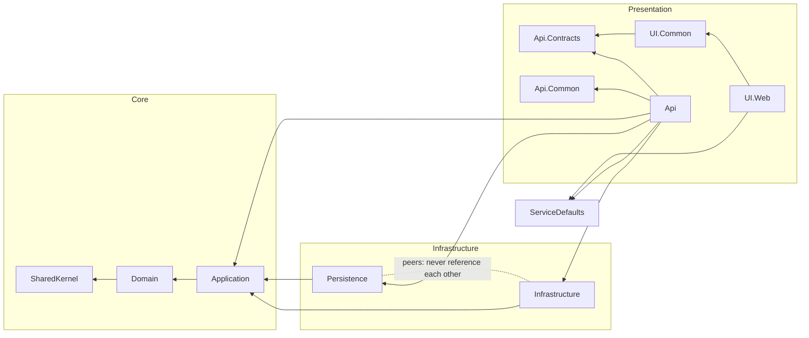

# XTemplate

[](https://github.com/your-org/xtemplate/actions/workflows/ci.yml)
[](LICENSE)
[](https://dotnet.microsoft.com/)

A best-practices .NET 10 **solution template**: rich DDD, Clean Architecture with vertical-slice features, feature-based Minimal APIs, separate Infrastructure and Persistence, ASP.NET Identity + JWT, Aspire orchestration, a Blazor UI, and a deeply **AI-friendly** repository (dual human/AI docs, Claude Code rules/agents/skills/hooks). Every major feature is a toggle, so you scaffold only what you need.

## Use the template

```bash
dotnet new install XTemplate.Templates
dotnet new xtemplate -n Your.Project
```

Toggles (checkboxes in Visual Studio / Rider, flags on the CLI):

| Flag | Default | What it adds |
|---|---|---|
| `--include-ui` | on | Blazor web UI (UI.Common + UI.Web), orchestrated by Aspire |
| `--use-redis` | off | Redis distributed cache as a HybridCache L2 |
| `--use-serilog` | off | Serilog structured logging (console) alongside OpenTelemetry |
| `--use-multitenancy` | off | Tenant seam: `ITenantContext`, `TenantId` column + `"Tenant"` query filter |
| `--include-ui-tests` | off | Playwright browser tests for the Blazor UI (opt-in at run time) |
| `--skip-restore` | off | Skip the automatic `dotnet restore` |

## Develop it

No .NET SDK on your machine? Open the solution and choose **Reopen in Dev Container** — the IDE
backend runs inside the SDK image, so you get full IntelliSense/build/debug with nothing installed
on the host. See [docs/development.md](docs/development.md).

## Run it

With a local .NET SDK, one command wires up everything:

```bash
aspire run        # PostgreSQL + migrations + API (Scalar at /scalar/v1) + Blazor UI + dashboard
```

From the **dev container** (no local SDK), start the dependencies and launch the projects from your
IDE with the `… (dev container)` profiles — `aspire run` can't orchestrate from inside a container
([ADR-0008](docs/adr/0008-containerized-sdk-and-aspire-orchestration.md)):

```bash
docker compose up -d    # PostgreSQL on host port 5433
```

then run **MigrationService** once, then **XTemplate.Api** (<http://localhost:5171>) and
**XTemplate.UI.Web** (<http://localhost:5170>).

Seeded admin: `admin@xtemplate.dev` / `Admin123!`. Full detail in [docs/development.md](docs/development.md).

## Architecture

Dependencies point inward; the arrows are enforced by `ArchitectureTests`.



| Group | Projects | Role |
|---|---|---|
| `src/Core` | SharedKernel, Domain, Application | The inside of the onion — pure C#, no framework deps |
| `src/Infrastructure` | Infrastructure ∥ Persistence | Driven adapters (peers — no cross-reference) |
| `src/Presentation/Api` | Api.Contracts, Api.Common, Api | Feature-based Minimal API host + shared plumbing + public contracts |
| `src/Presentation/UI` | UI.Common, UI.Web | Shared Blazor component library + the web host |
| `src/Shared` | ServiceDefaults | Aspire service defaults (OTel, health, discovery, resilience) |
| `tools` | AppHost, MigrationService | Aspire orchestration + DB migrate/seed worker |
| `tests` | 5 projects | Unit, architecture, integration (Testcontainers), E2E (Aspire.Hosting.Testing) |

## Highlights

- **Rich DDD** — aggregates with factories + private EF constructors, value objects as EF Core 10 complex types, hand-rolled strongly-typed IDs, domain events via a SaveChanges interceptor, specifications ([docs/features/invoices.md](docs/features/invoices.md) is the reference slice).
- **CQRS without a mediator** — hand-rolled handlers + a validation→logging→unit-of-work decorator pipeline; **no commercially-licensed packages** ([ADR-0011](docs/adr/0011-license-ceiling-policy.md)).
- **Result over exceptions**, mapped to RFC 9457 ProblemDetails at one seam.
- **AI-friendly** — `AGENTS.md`, path-scoped `.claude/rules`, agents, skills, a docs-drift hook, `.mcp.json`, and Architecture Decision Records.

## Contributing

See [CONTRIBUTING.md](CONTRIBUTING.md). Architecture decisions live in [docs/adr](docs/adr/); the docs index for both humans and agents is [docs/INDEX.md](docs/INDEX.md).

## License

MIT — see [LICENSE](LICENSE).
