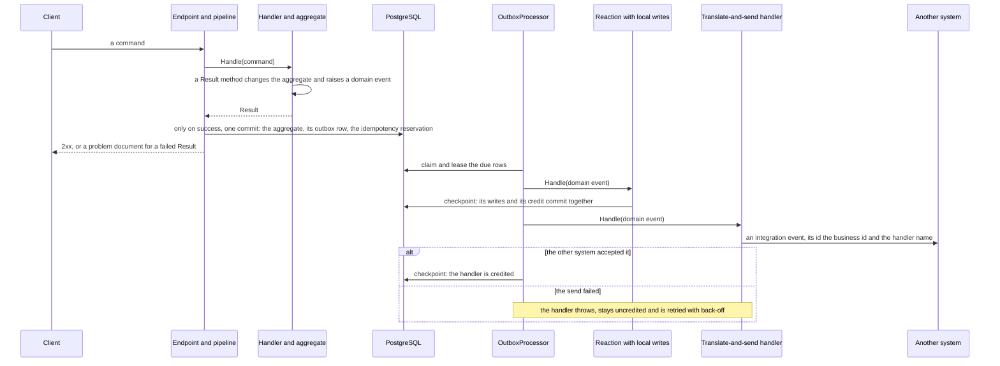

# Architecture

Trellis is a rich-DDD, Clean Architecture .NET 10 solution. Projects are grouped by architectural ring; features are vertical slices inside the layers.

## Dependency flow (enforced by `Trellis.ArchitectureTests`)

```
                 ┌─────────────── Core ───────────────┐
 SharedKernel ◄── Domain ◄── Application ◄──┐
                                            │
        ┌──────── Infrastructure ───────────┤   (Infrastructure ∥ Persistence:
        │  Infrastructure   Persistence ─────┘    peers, never reference each other — ADR-0002)
        │
        └──────── Presentation ────────────────
             Api ──► Api.Common ──► Api.Contracts
             Api ──► Api.Contracts ◄── UI.Common ◄── UI.Web
             Shared: ServiceDefaults (Aspire) — referenced by hosts
```

Rule of thumb: **dependencies point inward.** The Domain knows nothing about EF, HTTP, or DI. Application defines *ports* (interfaces); Infrastructure and Persistence implement them.

## The rings

| Ring | Projects | Responsibility |
|---|---|---|
| **Core** | SharedKernel, Domain, Application | Business rules + use cases. Pure C#. |
| **Infrastructure** | Infrastructure, Persistence | Driven adapters (email/JWT; EF Core/Identity). Peers. |
| **Presentation** | Api(.Common/.Contracts), UI(.Common/.Web) | Driving adapters: HTTP API + Blazor UI. |
| **Shared** | ServiceDefaults | Aspire cross-cutting (OTel, health, discovery, resilience). |
| **tools** | AppHost, MigrationService, Analyzers | Aspire orchestration, the DB migrate/seed worker, the RSLT001 analyzer (ADR-0030). |

## Key patterns

- **CQRS without a mediator** — hand-rolled `ICommandHandler`/`IQueryHandler` + a decorator pipeline (tracing → logging → validation → unit-of-work). Endpoints inject handlers directly; the stages are tabled below. (ADR-0003)
- **Result over exceptions** — operations return `Result`/`Result<T>`; the API maps errors to RFC 9457 problem details at one seam, every problem carrying a stable `code`. (ADR-0004, ADR-0024)
- **Secure by default** — every API endpoint requires authorization unless it is on the anonymous allowlist; hardening (forwarded-header trust, security headers, rate limits, request limits) lives in one place. (ADR-0021)
- **OpenAPI as a contract** — one generated document per API version, committed at `docs/api/openapi.v1.json` and compared with the served one on every test run. (ADR-0025)
- **Rich domain** — aggregates with factories + private EF constructors, value objects as EF complex types, hand-rolled strongly-typed IDs. (ADR-0005, ADR-0006)
- **Transactional outbox** — a SaveChanges interceptor writes each domain event to `OutboxMessages` in the same transaction as the aggregate change; `OutboxProcessor` (a background service in the API) dispatches them after commit, at least once, crediting each handler under its `[DomainEventHandlerName]` so a retry never re-runs one that succeeded. Nothing dispatches during `SaveChanges`; what each step guarantees is tabled below. (ADR-0018, ADR-0023)
- **Idempotent writes** — a write endpoint's `Idempotency-Key` reservation commits with the command's unit of work, and a retry replays the stored response. (ADR-0018)
- **Auth** — ASP.NET Core Identity + JWT with permission claims; permission-based authorization; single-use refresh tokens. (ADR-0007)
- **Shared UI library** — a render-mode-agnostic Razor Class Library (`UI.Common`) holds the pages/components/typed client, consumed by the Blazor web host. (ADR-0015)

## A request, stage by stage

The order a write passes through, outermost first; a query skips the unit of work. Each stage can end the
request, and its answer's `code` says which one did (`docs/development.md`, *When a request fails*).

| # | Stage | Where | What it can answer |
|---|---|---|---|
| 1 | Host | `UseCorrelationId`, `UseExceptionHandler`, `UseStatusCodePages`, `UseApiHardening` (forwarded headers, security headers, the request timeout, CORS) | `Http.*` for a bodyless status (an unknown route, the 504 timeout); `Server.Failure` 500 for any unhandled exception |
| 2 | Authentication, rate limiting, authorization | `UseAuthentication`, `UseApiRateLimiting`, `UseAuthorization`; the group's `RequireAuthorization()` and the endpoint's `RequirePermission` | 401 `Auth.Unauthenticated`, 429 `RateLimit.Exceeded`, 403 `Auth.Forbidden` |
| 3 | Binding and endpoint filters | the endpoint's parameters; `IdempotencyFilter` from `RequireIdempotency()` | 400 `Request.*`; `Idempotency.*` (400, 409, 422) or the stored response replayed |
| 4 | Tracing | `TracingDecorators` | nothing: opens the use case's span |
| 5 | Logging | `LoggingDecorators` | nothing: writes the outcome line inside that span |
| 6 | Validation | `ValidationDecorators` over the FluentValidation validators | 400 `Validation.General` with `errors[]`; the handler never runs |
| 7 | Unit of work, commands only | `UnitOfWorkDecorators`, `IUnitOfWork.CommitAsync` | commits a successful `Result` once, never a failed one; 409 `Concurrency.Conflict` or `Idempotency.Duplicate` from the commit |
| 8 | Handler | the `ICommandHandler`/`IQueryHandler` in Application, over the aggregate and the ports | its `Result`, which the endpoint maps with `TypedResults` or `CustomResults.Problem` |

Stages 4 to 8 are registered by `TryDecorate` in Application's `DependencyInjection` and pinned by
`DecoratorPipelineTests` (`.claude/rules/sharedkernel.md`, ADR-0003, ADR-0028). What an endpoint does after
a success (evicting the read cache) is post-commit work and runs with `CancellationToken.None`; domain
events leave through the outbox, after the commit (next section).

## Domain events and integration events

A domain event (`InvoicePaidDomainEvent`) says that something happened inside this application, in its
own terms. Its `[DomainEventName]` (`invoices.paid.v1`) is the key its outbox row is stored and found
under, stable so that a rename never orphans a row in flight; it is not a contract any other system may
depend on. To tell another system, publish an **integration event**: a separate record with a versioned
name of its own and only what the outside may know, built by a translate-and-send event handler
(`[DomainEventHandlerName("invoices.paid.publish")]`) from the domain event and, where needed, the
aggregate. That handler throws when the send fails, so the outbox retries it, and gives every message a
deterministic id (the business id and the handler's name) so a consumer can drop a redelivery. No broker
ships with the template: a transport means a NuGet package (ask first, and an ADR), and so does a project
to hold the published contracts.

What each step promises:

| What | Guarantee | Where |
|---|---|---|
| A command's own writes: the aggregate, its outbox rows, the idempotency reservation | one transaction, all or nothing | `UnitOfWorkDecorators`, `AppDbContext.CommitAsync` |
| A request retried with the same `Idempotency-Key` | applied once; the stored response is replayed | `IdempotencyFilter` (ADR-0018) |
| A domain event reaching its handlers | at least once, after the commit, never dropped: a message that keeps failing is dead-lettered, not lost | `OutboxProcessor` (ADR-0023) |
| A handler's own database writes | exactly once: they commit with the handler's credit at its checkpoint, and a credited handler never runs again for that row | the dispatcher's `checkpoint` |
| A handler's external side effect (an e-mail, a call out) | at least once: a crash between the call and the checkpoint repeats it, so key it on business identity and the handler's name | `.claude/rules/application.md` |
| A handler that keeps failing | retried alone with back-off while its siblings are credited, dead-lettered on the eighth failure, re-driven by hand | `Outbox` options, `docs/deployment.md` |



## Shipping `Api.Contracts` as a client package

`Api.Contracts` is the API's public surface (ADR-0013), and a project may publish it for its clients. The
OpenAPI snapshot then still catches a renamed or removed JSON member, but not a binary break: every
contract is a positional record, so even a change that is additive on the wire (a new optional member of
a request) changes the record's constructor and breaks code compiled against the previous package. A
project that publishes it turns on the SDK's package validation in the Contracts project
(`EnablePackageValidation`, with `PackageValidationBaselineVersion` set to the last published version and
bumped only after the next publish, because the baseline must restore), records a deliberate break in
`CompatibilitySuppressions.xml` (`-p:ApiCompatGenerateSuppressionFile=true`), and packs on every pull
request. The first release has no baseline to compare with, and a package on a private feed needs that
feed in `nuget.config` and its `packageSourceMapping` (the shipped file maps every package to nuget.org).

## Scheduled use cases

The template's own timers are bookkeeping (`OutboxProcessor`, `DataRetentionJanitor`); a feature's will
be business ("flag the invoices that went overdue", "send a reminder"). Give one this shape:

- **A hosted service in the API host, one scope per unit of work.** A `BackgroundService` waits on a
  `PeriodicTimer` built from the injected `TimeProvider` (a test moves the clock instead of sleeping). On
  each tick it opens a DI scope, asks a query handler for the ids that are due (a specification, such as
  `InvoiceSpecs.Overdue(now)`), then gives each id a scope and a command of its own: the job is a driving
  adapter like an endpoint, every command goes through the whole pipeline (span, outcome line,
  validation, one commit), and one aggregate's failure stays its own. The rule lives in the command
  handler, never in the timer; the instant comes from `TimeProvider` and travels in the command. The
  interval is a validated options class (`OptionsConventionTests`), the catch filter keys on the host
  token (`when (e is not OperationCanceledException || !stoppingToken.IsCancellationRequested)`), and a
  failed tick logs a Warning and waits for the next.
- **Idempotent through the aggregate, not a lock.** Every replica runs the same timer, and a tick can run
  again after a crash. The aggregate's state makes a repeat harmless: the query selects only aggregates
  still in the state the command changes, the transition refuses one that has moved on (a `Conflict`),
  and when two replicas reach the same aggregate together `xmin` lets one commit and answers the other
  `Concurrency.Conflict`. Both mean "already done": nothing to retry, no leader election, no lock table. A
  side effect per aggregate (an e-mail, a call out) goes in an event handler of the transition's event,
  so the outbox delivers it once the change has committed.
<!--#if (UseMultitenancy) -->
- **The tenant is not ambient in a job.** A job has no signed-in user, so no `tenant` claim:
  `ITenantContext.TenantId` is null, and the `"Tenant"` query filter then matches only rows whose
  `TenantId` is NULL, which no tenant's aggregate is. A job that serves tenants iterates them: read the
  tenant ids to serve (the distinct `TenantId` of the aggregate, with `IgnoreQueryFilters(["Tenant"])`),
  then run each tenant's work in its own scope with `AmbientTenant.CurrentTenantId` set to that tenant and
  reset in a `finally`, as `OutboxProcessor` restores a message's tenant. Rows the job creates are then
  stamped with that tenant too.
<!--#endif -->

Decisions and their rationale live in [`docs/adr/`](adr/). The canonical feature to copy is [Invoices](features/invoices.md).
