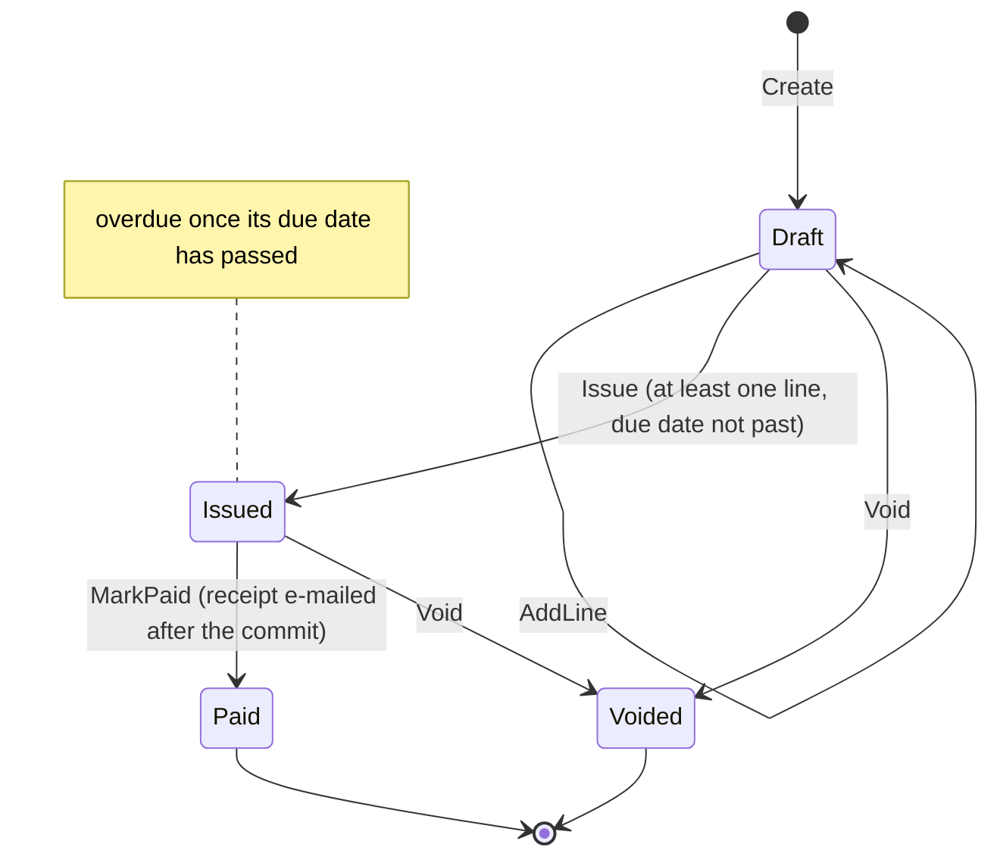
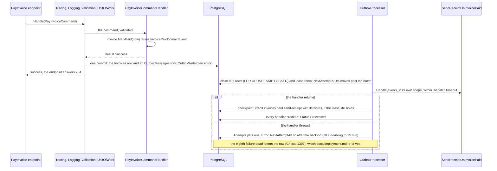

# Feature: Invoices

The **reference vertical slice** — the canonical shape to copy for new features (aggregates or use cases). It exercises every tactical pattern in the template.

## The domain in plain words

An invoice bills one customer, in one currency, for one or more lines of work. It starts as a
**draft**, the only state in which lines can be added. Every invoice is in the invoice list from the
moment it is created, newest first, and the list can be narrowed to one state. **Issuing** it freezes
the lines and sets a due date that may not lie in the past; an issued invoice whose due date then
passes also appears in the overdue list. **Paying** an issued invoice closes it and e-mails the
customer a receipt, **voiding** cancels a draft or an issued one, and a paid or voided invoice never
changes again.
Administrators may do all of this; members may only read.



Every arrow is a method on `Invoice` that returns a `Result`; a call from the wrong state answers a
409 (`Invoice.NotDraft`, `Invoice.NotIssued`, `Invoice.AlreadyIssued` or `Invoice.AlreadyFinalized`) and
changes nothing.

## Try it

Start the app (`aspire run`) and open `src/Presentation/Api/Trellis.Api/Trellis.Api.http` in Rider,
Visual Studio or VS Code with the REST Client extension. Set `@host` to the `api` resource's URL
from the Aspire dashboard (the IDE launch profiles and the dev container serve
`http://localhost:5171`) and choose the `dev` environment, which
`src/Presentation/Api/http-client.env.json` fills with the seeded admin and a demo member. Then
send the requests in order; each row shows a request, its body and what comes back, and the
placeholder variables at the top of the file name the response each value comes from.

| # | Request | Body | Answer |
|---|---|---|---|
| 1 | `POST /api/v1/auth/login` | `{"email": "admin@example.com", "password": "Admin123!"}` | 200 with an `accessToken`: paste it into `@token` |
| 2 | `POST /api/v1/invoices` with `Idempotency-Key: try-it-1` | `{"customerName": "Ada Lovelace", "customerEmail": "ada@example.com", "currency": "EUR"}` | 201, a `Location` header and the new `id`: paste it into `@invoiceId` |
| 3 | `GET /api/v1/invoices` | | 200: a `PagedResponse` whose first item is the draft from step 2; `?status=Draft` (or `Issued`, `Paid`, `Voided`) narrows it, and `GET /api/v1/invoices/overdue` lists only the issued invoices past their due date |
| 4 | `POST /api/v1/invoices/{id}/lines` | `{"description": "Analytical engine consulting", "amount": 1200.00}` | 204 |
| 5 | `POST /api/v1/invoices/{id}/issue` | `{"dueDate": "2099-12-31T00:00:00Z"}` | 204; a past date answers 400 `Invoice.DueDateInPast`. Step 3 again now shows it `Issued`, still first; the overdue list does not have it until 2099 |
| 6 | `GET /api/v1/invoices/{id}` | | 200: status `Issued`, total 1200.00, and an `ETag` header to paste into `@etag` |
| 7 | the same GET with `If-None-Match: {etag}` | | 304 and no body, until the invoice changes |
| 8 | `POST /api/v1/invoices/{id}/pay` | | 204; seconds later the api logs `E-mail not sent (Email:Provider=Logging) …`: the outbox handed `invoices.paid.v1` to `SendReceiptOnInvoicePaid` after the commit |
| 9 | step 5 again with `If-Match: {etag}` | same as step 5 | 412 `Invoice.VersionMismatch`: paying moved the version past the ETag you read in step 6, so nothing changes (without the header: 409 `Invoice.AlreadyFinalized`) |
| 10 | step 2 again, same key and body | same as step 2 | 201 with the same `Location` and `Idempotency-Replayed: true`; no second invoice exists |
| 11 | `POST /api/v1/auth/register` | `{"email": "member@example.com", "password": "Member123!"}` | 200 (Development opens self-registration); a 409 `Auth.EmailAlreadyInUse` on later runs is fine |
| 12 | `POST /api/v1/auth/login` as the member | as in step 11 | 200: paste its `accessToken` into `@memberToken` |
| 13 | `POST /api/v1/invoices` with the member's token | like step 2 | 403 `Auth.Forbidden`: members hold `invoices:read` only |

To walk through again, change `@createKey` first: the same key keeps answering with the first
invoice, paid by then, so steps 4, 5 and 8 would answer 409 (`Invoice.NotDraft`,
`Invoice.AlreadyFinalized`, `Invoice.NotIssued`). Tokens expire after 15 minutes, so send step 1
again when a request answers 401. Visual Studio and VS Code can chain the values instead of pasting
them, Rider through a response handler script; the file's header shows both.

<!--#if (!UseMultitenancy) -->
Step 3 sent with `@memberToken` lists the same invoices: a member may read every one, only not change it.
<!--#endif -->
<!--#if (UseMultitenancy) -->
Step 3 sent with `@memberToken` lists none of the admin's invoices: registering provisions a fresh
tenant (ADR-0022), and every list is scoped to the caller's tenant.
<!--#endif -->

<!--#if (IncludeUI) -->
The web UI (the `web` resource) walks the same lifecycle with clicks: sign in as the admin, create
an invoice, then add a line, issue and pay it from its detail page. The Invoices page lists every
invoice, newest first, filtered by state or to the overdue ones, and the detail and create pages
lead back to it.

<!--#endif -->
## Where the code lives

One folder per layer, one subfolder per use case:

```text
src/Core/Trellis.Domain/
├── Common/                     Money, Currency, EmailAddress: value objects
└── Invoices/
    ├── Invoice.cs              aggregate: Create/AddLine/Issue/MarkPaid/Void
    ├── InvoiceLine.cs          child entity, reachable only through Invoice
    ├── InvoiceId.cs            strongly-typed IDs (InvoiceLineId.cs alike)
    ├── InvoiceErrors.cs        one Error per rule: the codes clients branch on
    ├── InvoiceSpecs.cs         query shapes (All, Overdue), run by Persistence
    ├── IInvoiceRepository.cs   the port Persistence implements
    └── Events/                 Issued, Paid, Voided: by the outbox after commit
src/Core/Trellis.Application/Features/Invoices/
    ├── CreateInvoice/          command + handler + validator per use case
    ├── AddInvoiceLine/         IssueInvoice/ alike; PayInvoice/, VoidInvoice/
    │                           take only an id, so they carry no validator
    ├── GetInvoice/             query + handler; no validator for a route id
    ├── ListInvoices/           query + handler + validator (status and paging)
    ├── ListOverdueInvoices/    query + handler + validator (the paging bounds)
    ├── InvoicePreconditions.cs If-Match: NotFound first, then VersionMismatch
    ├── EventHandlers/          SendReceiptOnInvoicePaid, RecordInvoiceMetrics
    └── InvoiceResponse.cs      the read model the queries return
src/Infrastructure/Trellis.Persistence/
    ├── Configurations/         Invoice(Line)Configuration: the EF mapping
    └── Repositories/           InvoiceRepository
src/Presentation/Api/Trellis.Api.Contracts/Invoices/
    └── InvoiceContracts.cs     the wire records, shared with every client
src/Presentation/Api/Trellis.Api/
    ├── Features/Invoices/      one endpoint class per use case
    └── Trellis.Api.http        the requests behind "Try it" above
```

<!--#if (IncludeUI) -->
```text
src/Presentation/UI/Trellis.UI.Common/
    ├── Pages/                  Invoices, InvoiceDetail, CreateInvoice
    ├── Forms/InvoiceForms.cs   DataAnnotations mirroring the command validators
    └── Services/               IInvoiceApiClient over the contracts
```

<!--#endif -->
## Domain (`src/Core/Trellis.Domain/Invoices/`)

- **`Invoice`** — aggregate root (`AggregateRoot<InvoiceId>`, also `IAuditable`, `ISoftDeletable`).
  - Created via `static Create(customerName, EmailAddress, currency) → Result<Invoice>`; `private Invoice()` for EF.
  - Lengths live in the Domain and are checked there too, since not every caller has a validator (the seeder does not): `Invoice.CustomerNameMaxLength` (200, `Invoice.CustomerNameTooLong`) and `InvoiceLine.DescriptionMaxLength` (500, `Invoice.LineDescriptionTooLong`), both after trimming. The validators, the EF configurations and the UI forms use the same constants (the forms restate them: UI.Common sees only the contracts).
  - Lifecycle (each returns `Result`, raises events, enforces invariants): `AddLine` (Draft only) → `Issue(dueDate, now)` (needs ≥1 line, raises `InvoiceIssuedDomainEvent`) → `MarkPaid(paidAt)` (Issued only, raises `InvoicePaidDomainEvent`) / `Void()` (Draft or Issued; Voided is terminal).
  - Due date: `Issue` rejects a missing (`default`) or past due date — past relative to the `now` the handler takes from `TimeProvider` — with `InvoiceErrors.DueDateInPast` (400), and `IssueInvoiceCommandValidator` answers a body without one first; an invoice is never overdue the moment it is issued.
  - `Void()` raises `InvoiceVoidedDomainEvent` (wire name `invoices.voided.v1`); no handler ships with it — the outbox dispatches it to none and marks it processed, so subscribe when a reaction is needed.
  - `Total` computed from lines via `Money` operator overloads.
- **`InvoiceLine`** — child entity behind a read-only `Lines`; created only through `Invoice.AddLine`.
- **Value objects** (EF complex types): `Money(decimal, Currency)`, `Currency`, `EmailAddress` — each with `Create → Result<T>`.
  `Invoice.Currency` and `Money.Currency` are the `Currency` value object, validated once at creation (`Total` no longer re-validates a string on every read; `Money` nests `Currency` as a complex type inside a complex type, which is why it keeps a private parameterless constructor for EF). An amount carries at most its currency's ISO 4217 minor units (`Currency.MinorUnits`: 0 for JPY, 3 for KWD, 2 for most) and never more than `Money.AmountScale` (3), the scale it is stored with (`numeric(18,3)`): `Money.Create` refuses a finer amount with `Money.TooManyDecimalPlaces` instead of rounding it ("1000.50 JPY" is refused, "1.255 KWD" accepted), and an amount over `Money.MaxAmount` with `Money.AmountTooLarge`.
  `EmailAddress` is shallow on purpose but refuses what mail systems refuse: more than 254 characters or more than 64 before the `@` (`EmailAddress.TooLong`), whitespace, a leading, trailing or doubled dot, an empty domain label or one that starts or ends with a hyphen (`EmailAddress.Invalid`); any other character is allowed, so internationalized addresses pass. The `CustomerEmail` column stays 320 wide; the domain's 254 is the bound.
  `Currency` and `EmailAddress` are single values, so they implement `IScalarValueObject` and could be mapped as an indexable converted column (`ScalarValueObjectConverter`, one `ConfigureConventions` line per type); the slice needs no such index, so both stay complex types (ADR-0006, amendment of 2026-10-11).
- **Strongly-typed IDs**: `InvoiceId`, `InvoiceLineId` (`readonly record struct … : IStronglyTypedId<>, IParsable<>`).
- **`InvoiceSpecs.All(status)`** (every invoice, or those in one status, newest first: `CreatedAtUtc` descending, then `Id` descending as the unique tiebreaker), **`InvoiceSpecs.Overdue(now)`**, **`InvoiceErrors`**, **`IInvoiceRepository`**.

## Application (`src/Core/Trellis.Application/Features/Invoices/`)

Use-case slices, each = command/query + `internal sealed` handler: `CreateInvoice`, `AddInvoiceLine`, `IssueInvoice`, `PayInvoice`, `VoidInvoice`, `GetInvoice`, `ListInvoices`, `ListOverdueInvoices`. Each carries a validator too, except `PayInvoice`, `VoidInvoice` and `GetInvoice`: they take only the id the route has already bound, which leaves nothing to check. Plus `EventHandlers/SendReceiptOnInvoicePaid` (→ `IEmailSender`), `EventHandlers/RecordInvoiceMetrics` (→ `InvoiceMetrics`: the issued and paid counters, one handler per event) and `InvoiceResponse` (read model).

`CreateInvoiceCommandHandler` is the railway reference, one chain: `Result.Combine(EmailAddress.Create(…), Currency.Create(…))` creates both value objects before failing, so an invalid e-mail and an invalid currency come back in one 400, and the deconstructing `Bind((email, currency) => Invoice.Create(…))` hands both values on. `Combine` merges validation errors only; a 404 or a 500 among the failures is returned on its own (ADR-0024 amendment).

## From a payment to its receipt

Paying an invoice is one transaction; e-mailing the receipt is not. The command commits the invoice and
the event together, answers, and the outbox delivers the event to its handlers afterwards:



Every handler of the event (`RecordMetricsOnInvoicePaid` too) runs on each attempt, and only the ones that
failed are retried; a credited handler never runs again for that row (ADR-0023). Where a new reaction goes:

- **A reaction that must stand or fall with the command** (the caller must hear that it failed, nothing
  may commit without it) belongs in the command handler, on the same aggregate.
- **Anything that can happen later** is an event handler in `EventHandlers/`: it runs after the commit,
  at least once, and possibly twice (a crash between its side effect and its checkpoint repeats it), by
  which time the command has answered. A reaction that changes another aggregate loads it by id and calls
  one of its `Result` methods; the checkpoint commits it, never the handler.
- **A failed `Result` inside a reaction is a handler failure.** `Handle` returns `Task`, so the handler
  throws: the dispatcher records the failure for that handler alone (Warning 1304), its siblings still run,
  and the outbox retries it with back-off until it dead-letters, per ADR-0023. Throw when waiting can help
  (`Failure`, `Unavailable`); when it cannot (`Validation`, `NotFound`, `Conflict`), log the refusal or
  record it on an aggregate and return, which credits the handler: eight retries of a refusal only fill the
  dead-letter queue. The throw is the outbox's retry signal, the way `SmtpEmailSender` reports a failed
  send, so ADR-0004 holds.

## Persistence (`src/Infrastructure/Trellis.Persistence/`)

`InvoiceConfiguration` / `InvoiceLineConfiguration` (complex-type mapping, `AutoInclude`, `"SoftDeleted"` filter), `InvoiceRepository`, ID conventions in `AppDbContext`. With `UseMultitenancy`, the `TenantId` shadow column, its index and the `"Tenant"` filter come from the aggregate-root convention in `AppDbContext.OnModelCreating` (ADR-0022) — `InvoiceConfiguration` contains no tenant code, and neither should yours.

## API (`src/Presentation/Api/Trellis.Api/Features/Invoices/`)

One `IEndpoint` class per use case on `/api/v1/invoices…`, each `.RequirePermission(Permissions.Invoices.Read|Write)`, mapping `Result` → `TypedResults`/`CustomResults.Problem`. Wire contracts in `Api.Contracts/Invoices/`.

**Error contract** (ADR-0024): every failure is an RFC 9457 problem with a stable `code` (what clients branch on), `type` = `urn:problem-type:{code}`, a human `title`, `detail`, `instance`, `traceId` and `correlationId`. A 400 carries `errors[]` — one `{field, code, description}` per failure, `field` being the request's JSON path (validator failures: `customerName` / `Validation.NotEmpty`; value-object and aggregate-rule errors the handler attributes with `AtField`: `customerEmail` / `EmailAddress.Invalid` for `"a@b"`, `dueDate` / `Invoice.DueDateInPast`) or `null` for a whole-request error (`Invoice.NoLines`). `POST /invoices {"customerName":"","customerEmail":"x","currency":"USD"}` answers:

```json
{ "type": "urn:problem-type:Validation.General", "title": "Validation failed", "status": 400,
  "detail": "One or more validation errors occurred.", "instance": "/api/v1/invoices",
  "code": "Validation.General", "correlationId": "…", "traceId": "…",
  "errors": [ { "field": "customerName", "code": "Validation.NotEmpty", "description": "'Customer Name' must not be empty." } ] }
```

The slice's codes: `Invoice.NotFound` (404), `Invoice.NotDraft` / `Invoice.NotIssued` / `Invoice.AlreadyIssued` (issuing an issued invoice) / `Invoice.AlreadyFinalized` (changing a paid or voided one) (409), `Invoice.NoLines` / `Invoice.CurrencyMismatch` (400, `field: null`), `Invoice.DueDateInPast` (400, `field`: `dueDate`), `Invoice.VersionMismatch` (412, a stale `If-Match`), `Invoice.EmptyCustomerName` / `Invoice.CustomerNameTooLong` (400, `field`: `customerName`), `Invoice.EmptyLineDescription` / `Invoice.LineDescriptionTooLong` (400, `field`: `description`), `EmailAddress.*` and `Money.*` from the value objects (400, `field`: `customerEmail`, `currency` or `amount`), `Idempotency.InvalidKey` / `Idempotency.KeyRequired` (400), `Idempotency.InFlight` / `Idempotency.Duplicate` (409) and `Idempotency.FingerprintMismatch` (422) from the idempotency filter (`Duplicate` also from the unit of work when two firsts race), `Concurrency.Conflict` (409) from the unit of work. A new error is a new `InvoiceErrors` member — nothing changes in the API.

**Caching**: `GetInvoice` is cache-aside via `HybridCache` (key from the injected `CacheKeys` service); the mutating endpoints (`AddInvoiceLine`, `IssueInvoice`, `PayInvoice`, `VoidInvoice`) invalidate that key on success. A miss is never pinned (the stored null is removed so a later create isn't answered 404 for the TTL), and with the **`UseMultitenancy`** toggle the key carries the tenant — a cache hit bypasses the EF tenant filter, so unscoped keys would leak across tenants. HybridCache uses an in-memory L1 always; a Redis L2 is added when the **`UseRedis`** template toggle is on (Aspire `cache` resource + `AddRedisDistributedCache`). Entries live 30 s in the L1 and 5 min in the L2 (`DefaultEntryOptions` in `Program.cs`): eviction reaches only the instance that handled the write (and the shared L2), so another API replica may serve the previous state, and its ETag, for up to 30 s.

**Pagination**: both lists are paged — `GET /invoices` (every invoice from the moment it is created) and `GET /invoices/overdue` (issued invoices past their due date) take `?page=` (1..10000, default 1) and `?pageSize=` (1..100, default 20), bound inline with `[Range(PagingLimits.…)]` so the document states the camelCase names and the bounds (ADR-0025); `ListInvoicesQueryValidator` and `ListOverdueInvoicesQueryValidator` enforce the same bounds (a value outside answers 400 `Validation.General` with `field: "page"` / `"pageSize"`), and the response is `PagedResponse<InvoiceDto>` (items + total count + page metadata). `GET /invoices` also takes an optional `?status=` (`Draft`, `Issued`, `Paid` or `Voided`, the string enum the document declares): a name outside the enum is a 400 `Request.Malformed` whose `detail` names the parameter, and an ordinal the enum does not define (`?status=99`) a 400 `Validation.General` with `field: "status"`. Each query flows through the repository's `ListPagedAsync` over the existing `Specification<T>` seam, which pages with checked arithmetic (the page cap keeps `OFFSET` bounded; an offset can never wrap negative). `GET /invoices` is ordered newest first (`CreatedAtUtc` descending, then id descending), the overdue list by due date, then by id: each ends with the unique tiebreaker every paged specification must end with (`ListPagedAsync` refuses one that does not, or that pages itself), so invoices created or due at the same instant never repeat or vanish across pages. Neither list is cached.

**Optimistic concurrency**: `Invoice` carries the Postgres `xmin` concurrency token (`InvoiceConfiguration.UseXmin...`). A conflicting write is an expected outcome, not an exception: `IUnitOfWork.CommitAsync` (`AppDbContext`) turns EF's `DbUpdateConcurrencyException` into `UnitOfWorkErrors.ConcurrencyConflict` (`Concurrency.Conflict`), the UnitOfWork decorator returns it as the command's `Result`, and the endpoint maps it to **409** through `CustomResults` like any other conflict (logged at Information, no exception handler involved). The token guards the whole aggregate: adding a line changes only `InvoiceLines`, yet the save still writes the `Invoices` row (`AggregateConcurrencyInterceptor` marks a root column modified when only children changed), so two concurrent `AddLine`s on one invoice conflict rather than both committing (ADR-0006).

**Transactional outbox**: `MarkPaid` raises `InvoicePaidDomainEvent`, which the `OutboxWriteInterceptor` persists to `OutboxMessages` in the same transaction; the `OutboxProcessor` background service dispatches it post-commit to `SendReceiptOnInvoicePaid` (ADR-0018). Domain events use primitive types so they serialize, and every event carries a stable wire name (`[DomainEventName("invoices.paid.v1")]`) so renaming a class never orphans in-flight rows (a serialization fitness test enforces both). Dispatch is production-shaped (ADR-0023): a short `FOR UPDATE SKIP LOCKED` claim leases a batch in raise order (replicas never double-dispatch, and the lease is also the fence — `NextAttemptAtUtc` is the row's concurrency token, so a processor that outlived its lease books `lease_lost` instead of overwriting what the next claimant wrote), every message is then dispatched in its own scope outside the transaction, and each handler is credited under its stable `[DomainEventHandlerName]` (never its CLR name, so a rename cannot re-run it) with its own commit — the checkpoint — so a retry never re-runs a handler that already succeeded and a credited handler's writes are never lost. Every uncredited handler runs on every attempt and only the failed ones are retried (a receipt that cannot be sent never delays the metric behind it; the row's `Error` names the failing handlers). Failures back off exponentially (30 s, 1 m, 2 m, 4 m, 8 m, 15 m, 15 m; `Outbox` config section) and the message is **dead-lettered** on the eighth failure (≈45 min), as are an unknown event type and an unparsable payload at once — with a critical log and the `trellis.outbox.dead_lettered` counter, never dropped silently; `docs/deployment.md` has the re-drive runbook. A handler past `Outbox:DispatchTimeout` is cancelled and retried like any failure; a stopping host hands its unfinished leases back. Each row also carries the originating `traceparent` (dispatch spans rejoin the request's trace) and, with multi-tenancy, the originating tenant (restored via `AmbientTenant` while handlers run). A `DataRetentionJanitor` prunes processed rows, stale idempotency keys and dead refresh tokens on a timer (`Retention` config section).

**Idempotency** (ADR-0018 amendment): the invoice command endpoints accept an `Idempotency-Key` header (one value, max 128 chars and not blank, else **400** `Idempotency.InvalidKey` — a repeated header or a comma-separated list is never joined into one key, and a blank value is never a silent opt-out). `POST /invoices` requires it (`RequireIdempotency(keyRequired: true)`: a request without one is **400** `Idempotency.KeyRequired`), because an accidental repeat of a create is a second draft; the writes to an existing invoice let a caller omit it to opt out. The key is scoped `(user, method, route, key)` — different callers or endpoints reusing a value never collide. The reservation is tracked in the command's own unit of work and committed with the aggregate and the outbox, so a command that fails (validation 400, 404, `Concurrency.Conflict`, an exception) leaves **no** reservation and the same key may be retried as is; two concurrent firsts both run and the loser's commit hits the `IdempotencyKeys` primary key, which `AppDbContext.CommitAsync` returns as **409** `Idempotency.Duplicate` (its whole unit of work rolled back). Once the response has gone out, its status, content type, body and `Location` are stored against the key together with the request fingerprint (method + path + canonical JSON of the bound body). A retry of a completed request with the same fingerprint is answered with that stored response **byte for byte** — same status (201 or 204), body, content type and `Location` — plus `Idempotency-Replayed: true`; the same key with a different body (or method or path) is **422** `Idempotency.FingerprintMismatch`; a retry while the first request is still running is **409** `Idempotency.InFlight` with `Retry-After: 1`. Response bodies are stored up to 64 KB (`RequireIdempotency(maxReplayBodyBytes:)` raises it per endpoint): a larger response completes normally but is not replayable, so its retry is a 409 `Idempotency.Duplicate` whose `detail` says to read the resource. Work an endpoint does after its command committed (the read-cache invalidation) runs with `CancellationToken.None`; a fault there ends the request with a 500 but the retry is still a 409, never a second apply. Known residue: a crash between the commit and the completion write leaves the key in flight (409 `Idempotency.InFlight`) until `Retention:IdempotencyKeyAge` (default 2 days) sweeps it — read the resource. The UI's typed client sends a fresh key per logical POST (`ApiHeaders.IdempotencyKey`); ServiceDefaults' blanket resilience handler never retries POST, PUT, PATCH or DELETE, so a lost response is not re-sent behind the caller's back.

**Business metrics**: `InvoiceMetrics` (meter `Trellis.Invoices`, exported by every host through ServiceDefaults' `Trellis.*` subscription) exports `trellis.invoices.issued` (attribute `trellis.invoice.currency`) and `trellis.invoices.paid`, unit `{invoice}`, incremented by outbox-dispatched event handlers so they count only committed events.

**Conditional GET**: `InvoiceDto.Version` (a `long`, `format: int64`) surfaces the xmin concurrency
token, `GET /invoices/{id}` emits it as a strong ETag (`"42"`: the version moves with every change, a
line's included) and declares `.SupportsConditionalGet()`, so the document lists `If-None-Match`, the
`ETag` header and the 304. The header is parsed, not string-compared (RFC 9110 §13.1.2): the strong
form, the weak form `W/"42"`, a list and `*` all answer **304** with no body, a stale or unparsable tag
answers 200 — pollers stop re-downloading unchanged aggregates. The 200 and the 304 set
`Cache-Control: private, no-cache` themselves, the one opt-out from the API's `no-store` default
(ADR-0021 amendment): a browser may keep the invoice but revalidates it with the ETag before each use,
while the 404 and every other API response stay `no-store`.

**Conditional writes** (ADR-0025 amendment): `AddInvoiceLine`, `IssueInvoice`, `PayInvoice` and
`VoidInvoice` take an optional `If-Match` with that ETag (`.SupportsConditionalWrite()`). The endpoint
passes the version to the command's `ExpectedVersion`, the handler compares it with the loaded invoice
(`InvoicePreconditions.ToWrite`), and a version the invoice has moved on from is **412**
`Invoice.VersionMismatch` that changes nothing: a colleague's new line can no longer be issued unseen.
`*` or no header is unconditional (no 428); a weak tag, a list or a value the API never issued (`"042"`
included) is a 412 too, before the lookup; a missing invoice stays a 404 for a well-formed tag. xmin still guards the remaining load-to-commit window with a 409.
The read cache's 30 s L1 can hand a client that reloads from another replica the same stale ETag, so a
412 can repeat until the entry expires; and the idempotency fingerprint ignores headers, so a retry with
the same key and another `If-Match` replays the first answer.

**Wire types**: `InvoiceDto.Status` (and the list's `?status=`) is the Contracts enum `InvoiceStatus`
serialised by name (`"Draft" | "Issued" | "Paid" | "Voided"`, a string enum in the document;
`ContractMirrorTests` keeps it equal to the domain enum, and `ContractMappings.ToDomain` maps the query
value by name), money is `decimal` (`format: decimal`) and `InvoiceDto.CreatedAtUtc` is the audit
column the list orders by (`format: date-time`).

**OpenAPI** (ADR-0025): `/openapi/v1.json` describes exactly the v1 operations with concrete `/api/v1/…`
paths and no `servers`; every operation's `operationId` is its endpoint class (`CreateInvoice`,
`GetInvoice`, …); the bearer security scheme is declared (Scalar can authorize); every operation
documents its error responses by shape — 400 where there is input, 404 where a route id can miss, 409 on
a write to an addressed resource (and the `Idempotency-Key` header, the `Idempotency-Replayed` response
header, the duplicate and in-flight 409 and the fingerprint-mismatch 422 on every `RequireIdempotency()`
endpoint), `If-Match` and the 412 on the four conditional writes, 401/403 on secured ones, 429 and 500
everywhere — all referencing the `ProblemResponse` component generated from the Contracts record; the
201 declares `Location`. The document is committed at
`docs/api/openapi.v1.json` as the server serialises it: `OpenApiSnapshotTests` compares it with the
in-process host on every test run (`UPDATE_OPENAPI_SNAPSHOT=1 dotnet test tests/Trellis.ApiTests` or
`scripts/export-openapi.sh` regenerates it) and CI diffs it against the running app.

## UI (`src/Presentation/UI/Trellis.UI.Common/Pages/`)

`Invoices` (every invoice, newest first, with a Created column and pager controls; a filter row of links — All, Draft, Issued, Paid, Voided, Overdue — keeps the filter in the address, `invoices?status=Draft`, so Back returns to the previous one and a filtered list can be bookmarked: All and the four statuses call `ListAsync`, Overdue calls `GetOverdueAsync`, the current link is `aria-current`, a new filter starts at page 1, and the empty state and the pager name it, "No overdue invoices.", "Page 1 of 3 (42 invoices)"), `InvoiceDetail` (the full lifecycle: add lines and issue while Draft, pay/void after; action errors are kept separate from load errors so they survive the post-action reload), `CreateInvoice` — via `IInvoiceApiClient` over the contracts. The detail and create pages open with a "Back to invoices" link above the heading (there while the invoice loads, and after a failed load); a successful create still lands on the new invoice's detail page. The create, add-line and issue forms validate before sending with DataAnnotations that mirror the command validators (`Forms/InvoiceForms.cs`: required, lengths, amount ≥ 0); the issue form's date picker starts at tomorrow (UTC), the first due date the API accepts (`Invoice.DueDateInPast`). What the API still rejects comes back as `errors[]`: each field error under its input, a whole-request error (`field: null`) in the form's alert (`ServerValidation`). Created, issued, paid and voided are announced as notifications. Every write on the detail page sends the version the page loaded as `If-Match`; a 412 reads "Someone else changed this in the meantime" over the reloaded invoice. The session outlives the 15-minute access token: `TokenAuthenticationStateProvider` checks `exp` and rotates through `POST /auth/refresh` (single-flight, since refresh tokens are single-use); `BearerTokenHandler` always attaches a currently-valid token via `IAccessTokenSource`.

## Tests

- `Domain.UnitTests/Invoices`: invariants, events, the list and overdue specifications, ID parsing.
- `Application.UnitTests/Features/Invoices/<UseCase>` (one folder per use case, the event handlers under
  `EventHandlers/`): the handlers, and the validators' bounds at the Domain constants; every use case
  through the real pipeline.
- `IntegrationTests` against PostgreSQL: roundtrip, spec→SQL, interceptors, soft-delete, concurrency.
  The outbox suites: `OutboxTests` (paying writes the event in the same transaction and the processor
  sends the receipt after commit), `OutboxRetryTests` (back-off and the per-handler checkpoint, a failing
  first handler and two failing handlers with their siblings still run and credited, dead letter on
  exhaustion, unknown types and poison payloads, two processors dispatching once, leases,
  a processor that outlived its lease fenced off the row, a batch cut short of its lease, the raise
  order of one save's events, the dispatch timeout, a downstream cancellation as a retryable failure,
  a failed bookkeeping save contained to its own message, the backlog gauges, leases released on
  stop, the processor loop itself — a full batch drained without a sleep, a failed poll logged and
  retried after the interval, a clean stop — and the runbook's re-drive statement executed as written,
  the credited receipt not re-sent), `OutboxBackoffTests`
  (the 30 s → 15 min schedule and the derived lease) and `OutboxOptionsTests` (the `Outbox` section's
  defaults and limits). `IdempotencyStoreTests`: the three lookup states, the primary-key race and
  retention. `InvoicePersistenceTests` and `SpecificationPagingTests` translate both list specifications
  to SQL, the invoice list newest first with the id tiebreak against PostgreSQL. With multi-tenancy,
  `TenancyTests`: stamping, filtering (the invoice list through the pipeline included), the
  aggregate-root convention, outbox tenant restore.
- `ApiTests` (in-process, the real HTTP pipeline): the lifecycle and error contracts;
  `CommitFailureTests` (a commit conflict is a 409 and a throwing commit an opaque 500, neither leaving
  a reservation); `IdempotencyReplayTests` (a retry replays the stored 201/204 with
  `Idempotency-Replayed`, a different body is a 422, two firsts held at a commit barrier yield one 201
  and one 409 `Duplicate`, a request gated after its commit makes the retry a 409 `InFlight` until it
  completes, a failed command leaves no reservation, a response over the replay cap completes but its
  retry is a 409); `IdempotencyPostCommitTests` (a disconnect after the commit keeps the key and the
  retry replays the 204); `InvoiceReadCacheTests` (every write evicts the cached invoice and retires its
  ETag, a 404 is never cached); `InvoiceContractTests` (304 for every matching `If-None-Match` form,
  `private, no-cache` on the 200 and the 304 while other reads stay `no-store`, a current `If-Match`
  applies and a stale, weak, listed, zero-padded or foreign one is a 412 that changes nothing, a missing
  invoice stays a 404 for a well-formed tag, paging bounds answer 400 naming the field on both lists,
  `Location` resolves, a created-then-issued invoice heads `GET /invoices` for the admin and a reader
  and is absent from the overdue list, a status narrows the list and one outside the enum is a 400);
  `OpenApiSnapshotTests` +
  `OpenApiDocumentTests` (the committed document is the served one and says all of this); with
  multi-tenancy, `TenantIsolationTests` (cross-tenant read/write 404, scoped invoice and overdue lists,
  header ignored, cache scoped; the all-options leg runs it). `InvoiceApiFlowTests` is the opt-in Aspire E2E.
- `ApiTests/Ui`: the forms' validator mirrors and due-date floor, `errors[]` placed under their
  inputs, success notifications, the loaded version sent as `If-Match` and the list's query string per
  filter (`InvoiceApiClientTests`); `InvoicePagesTests` renders the pages: the API call and the current
  link for every filter in the address, the empty state and pager naming the filter, the Created column,
  and the back link on the detail (loaded or not) and create pages.
<!--#if (IncludeUiTests && IncludeUI) -->
- `UiTests` (Playwright, opt-in): sign in, create, issue due in 30 days, return through the back link
  and find the invoice heading the list under All and absent under Overdue.
<!--#endif -->

## Endpoints

| Method | Route | Permission |
|---|---|---|
| POST | `/api/v1/invoices` | invoices:write |
| POST | `/api/v1/invoices/{id}/lines` | invoices:write |
| POST | `/api/v1/invoices/{id}/issue` | invoices:write |
| POST | `/api/v1/invoices/{id}/pay` | invoices:write |
| POST | `/api/v1/invoices/{id}/void` | invoices:write |
| GET | `/api/v1/invoices` | invoices:read |
| GET | `/api/v1/invoices/{id}` | invoices:read |
| GET | `/api/v1/invoices/overdue` | invoices:read |

> When you change this feature's behavior, update this file (the CI docs-drift check enforces it).
